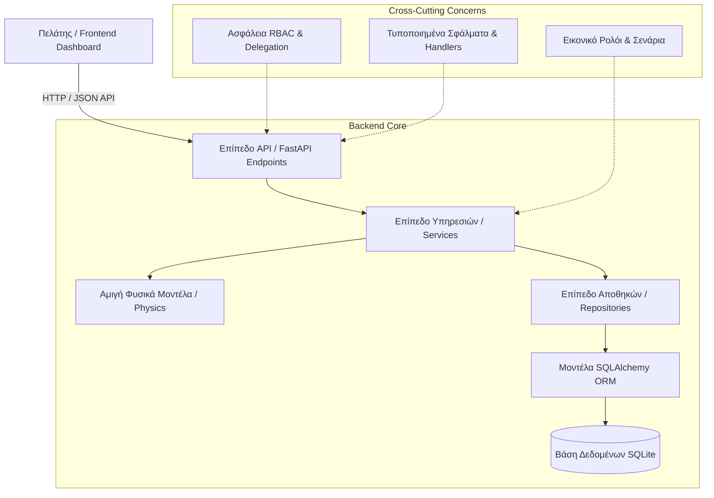
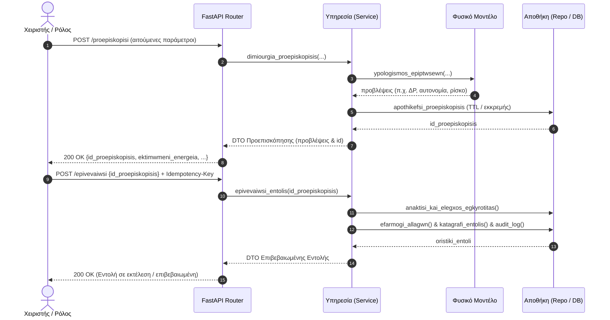

# 02 - Αρχιτεκτονική Συστήματος

## 1. Πολυεπίπεδη Αρχιτεκτονική (Layered Architecture)
Το backend του **Smart Mars Colony** ακολουθεί αρχιτεκτονική διαχωρισμού ευθυνών (Separation of Concerns) με αυστηρά οριοθετημένα επίπεδα:

## 2. Περιγραφή Επιπέδων

### 2.1 Επίπεδο Διεπαφής (API Routers - `backend/app/api/v1/`)
- Υπεύθυνο για την επικύρωση εισόδου (Pydantic DTOs), την ανάλυση επικεφαλίδων ταυτοποίησης (`X-ID-Xristi`, `X-Rolos`, `Idempotency-Key`), και τη δρομολόγηση στις αντίστοιχες υπηρεσίες.
- Επιστρέφει τυποποιημένες αποκρίσεις και διαχειρίζεται τα HTTP status codes.

### 2.2 Επίπεδο Υπηρεσιών (Domain Services - `backend/app/ypiresies/`)
- Υλοποιεί την επιχειρησιακή λογική της αποικίας.
- Συνδυάζει φυσικούς υπολογισμούς με αποθήκευση κατάστασης, ελέγχει τα όρια ασφαλείας, παράγει συναγερμούς και καταγράφει ενέργειες στο ιστορικό ελέγχου.
- Υποστηρίζει τη διφασική εκτέλεση εντολών: Προεπισκόπηση (`proepiskopisi`) -> Επιβεβαίωση (`epivevaiwsi`) ή Ακύρωση (`akyrwsi`).

### 2.3 Επίπεδο Φυσικών Μοντέλων (Pure Physics Models - `backend/app/fysika_montela/`)
- Αμιγείς συναρτήσεις χωρίς παρενέργειες (stateless & pure functions).
- Εφαρμόζουν φυσικούς νόμους μεταφοράς θερμότητας, ηλιακής ισχύος, ηλεκτροχημικής αποθήκευσης, κινηματικής rover και διατήρησης μάζας.
- Επιτρέπουν εξαντλητικές δοκιμές μονάδας (unit tests) με απόλυτο ντετερμινισμό.

### 2.4 Επίπεδο Αποθηκών (Repositories - `backend/app/apothikes/`)
- Απομονώνει την πρόσβαση στη βάση δεδομένων και τη σύνταξη ερωτημάτων SQLAlchemy.
- Παρέχει μεθόδους εύρεσης, καταχώρισης και ενημέρωσης οντοτήτων.

### 2.5 Επίπεδο Δεδομένων (ORM & SQLite - `backend/app/montela/`)
- Ορισμός 24 πινάκων που καλύπτουν όλες τις οντότητες της αποικίας.
- Αυστηρή επιβολή ξένων κλειδιών (`PRAGMA foreign_keys = ON;`).

## 3. Ροή Εκτέλεσης Διφασικής Εντολής (Preview - Confirm Pattern)

