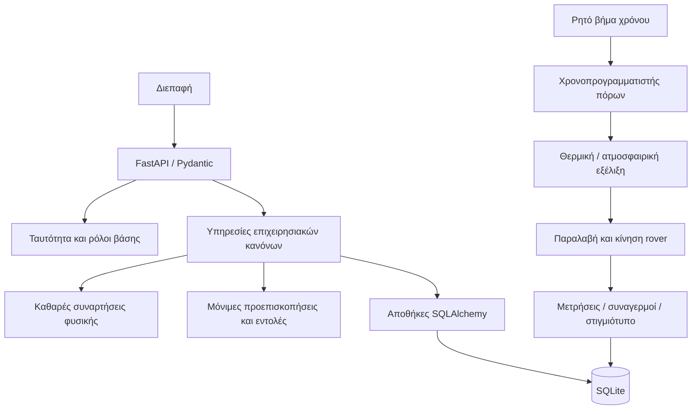
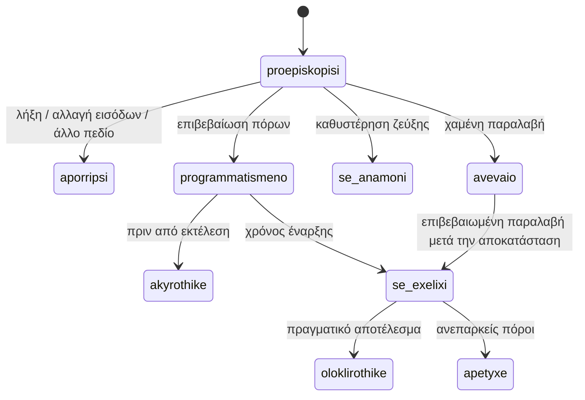

# Αρχιτεκτονική και κύκλος εντολής

Το API επικυρώνει το αίτημα και την ταυτότητα. Η υπηρεσία αναλαμβάνει τον επιχειρησιακό κανόνα, η αποθήκη τα ερωτήματα και ο μαθηματικός πυρήνας τις μονάδες/εξισώσεις. Τα κοινά DTO δεν εισάγουν δρομολογητές. Το lifespan χρησιμοποιεί τον ίδιο πάροχο συνεδρίας με τα tests και δεν εισάγει δεδομένα επίδειξης σε παραγωγικό περιβάλλον.

Οι κοινές βοηθητικές συναρτήσεις δεν κάνουν commit. Η σύνθετη απόφαση καταιγίδας καταναλώνει preview, εφαρμόζει πολιτική, υποβάλλει τυχόν εντολή rover και γράφει απόφαση/ιστορικό σε μία συναλλαγή. Η αποτυχία επαναφέρει όλα αυτά. Το no-op UPDATE στο κοινό ρολόι αποκτά SQLite writer lock πριν από κρίσιμες αναγνώσεις· το `version_id_col` εμποδίζει παλιά εγγραφή χώρου/δεξαμενής. Τα previews συγκρίνουν πλήρη δεδομένα που επηρεάζουν τον υπολογισμό. Τα αιτήματα επανάληψης δεσμεύονται σε χρήστη/ενέργεια/στόχο/σώμα.

Οι χρονοπρογραμματιστές δεν εκκινούν κρυφό νήμα ούτε αλλάζουν το ρολόι μόνοι τους. Το κοινό βήμα είναι ο μοναδικός ενορχηστρωτής. Οι εσωτερικές καταστάσεις δεν περνούν όλες υποχρεωτικά από κάθε θεωρητικό στάδιο: μία τοπική αλλαγή στόχου επιβεβαιώνεται άμεσα, ενώ μία εντολή με καθυστέρηση απαιτεί μεταγενέστερη παραλαβή.
