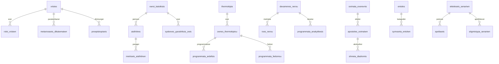

# Σχήμα, μεταναστεύσεις και διατήρηση δεδομένων



Τα πραγματικά ονόματα κλειδιών και δείκτες βρίσκονται στα `montela/*.py`. Τα προγράμματα κρατούν προγραμματισμένη και εκτελεσμένη ποσότητα/ενέργεια, στόχο, παράθυρο χρόνου και συσχέτιση `id_entolis`. Η συσχέτιση αυτή είναι nullable χωρίς FK για αποφυγή κυκλικών εξαρτήσεων reset. Δεν διαφημίζεται ως σχέση που εγγυάται ξένο κλειδί. Το ιστορικό είναι append-only μέσω API· το αρχείο SQLite δεν είναι κρυπτογραφικά αμετάβλητο.

Αλυσίδα: `1c63bef8cc3e` → `c551f5a42528`. Το αρχικό revision δεν αντικαθίσταται από «νέο αρχικό σχήμα». Η νέα μετανάστευση αναγνωρίζει παλιό `active_scenario` ή ήδη διορθωμένο `energo_senario`, προσθέτει μόνιμα previews/κατάσταση scheduler/ποιότητα/διαδρομές και μετονομάζει παλιά ιδιόκτητα πεδία σε Greeklish (`seed→sporos`, `email→ilektroniki_dieythynsi`, `roloi_xristwn.id→id_rolou`, `dedomena_snapshot→dedomena_stigmiotypou`).

Η παλιά έκδοση αφαιρούσε άμεσα το νερό προγραμματισμένης άρδευσης. Η αναβάθμιση επιστρέφει αυτές τις εκκρεμείς δεσμεύσεις στη φυσική στάθμη μία φορά, ελέγχει χωρητικότητα **πριν από DDL** και γράφει αιτιολογημένο ιστορικό. Παλιές ιστορικές ροές άρδευσης απενεργοποιούνται. Αν το παλιό απόθεμα δεν συμφωνεί, η αναβάθμιση σταματά αντί να κρύψει την απόκλιση. Οι ήδη υπάρχουσες εγγραφές διατηρούνται· η επαναλήψιμη αρχικοποίηση προσθέτει μόνο τα νέα εκπαιδευτικά στοιχεία.

Σε κανονικές συνδέσεις ενεργοποιούνται FK, WAL και busy_timeout5s. Στο SQLite batch DDL τα FK απενεργοποιούνται προσωρινά στη συγκεκριμένη σύνδεση και έπειτα εκτελείται `PRAGMA foreign_key_check`. Το `alembic check` ελέγχει metadata/schema. Οι χρόνοι γράφονται UTC και ανακτώνται με offset· παλιά naive timestamps ερμηνεύονται ως UTC. Τα payloads νέων προγραμμάτων απαιτούν ζώνη ώρας.

## Ασφαλής τοπική αναβάθμιση

Σταματήστε τον τοπικό διακομιστή. Κρατήστε συνεπές αντίγραφο με το SQLite backup API, και κρατήστε την παλιά έκδοση του κώδικα. Το απλό αντίγραφο του `.db` ενώ υπάρχει ενεργό WAL δεν είναι επαρκής διαδικασία.

```sh
uv run --frozen alembic upgrade head
uv run --frozen python -m scripts.arxika_dedomena
uv run --frozen alembic check
```

Μην χρησιμοποιείτε reset για αναβάθμιση. Σε αποτυχία διατηρήστε το αρχικό αντίγραφο και διαγνώστε το μήνυμα. Για πλήρη επαναφορά σταματήστε τη σύνδεση, επαναφέρετε το backup μαζί με την αντίστοιχη έκδοση κώδικα και αφαιρέστε μόνο τα ασύμβατα προσωρινά WAL/SHM με κλειστές συνδέσεις. Το downgrade ελέγχεται ως προς το σχήμα, αλλά **δεν ανακτά νέα πεδία ή χρονικά αποτελέσματα**· η ασφαλής επιστροφή πραγματικών δεδομένων γίνεται από backup.

Οι δοκιμές `test_metanastefseis_anavathmisis.py` ελέγχουν fresh upgrade, παλιό/νέο όνομα στήλης, διάσωση δεδομένων, συμφωνία δεσμεύσεων, FK, κύκλο downgrade/upgrade και `alembic check`.
