# 03 - Σχεδιασμός Βάσης Δεδομένων και Μοντέλα

## 1. Τεχνολογική Επιλογή και Ρυθμίσεις
- **Μηχανή Βάσης:** SQLite 3 μέσω SQLAlchemy 2.0.
- **Ενεργοποίηση Περιορισμών:** Σε κάθε σύνδεση εκτελείται αυτόματα `PRAGMA foreign_keys = ON;` ώστε να εξασφαλίζεται η ακεραιότητα αναφορών.
- **Σειριοποίηση JSON:** Οι στήλες JSON χρησιμοποιούν ειδικό σειριοποιητή `json_serializer=lambda obj: json.dumps(obj, default=str)` για ασφαλή αποθήκευση `datetime` και DTO αντικειμένων.
- **Διαχείριση Σχημάτων (Migrations):** Πλήρης υποστήριξη Alembic με λειτουργία batch mode (`render_as_batch=True`).

## 2. Διάγραμμα Οντοτήτων - Συσχετίσεων (ERD)

```mermaid
erDiagram
    XRISTIS ||--o{ METAVIVASI_DIKAIWMATOS : "ekxwrei / lamvanei"
    XRISTIS ||--o{ KATAGRAFI_ELEGXOU : "ektelei"
    XRISTIS ||--o{ ENTOLI : "ekdidei"
    
    THALAMOS ||--o{ METRISI_THALAMOU : "periexei"
    THALAMOS ||--o{ RYTMIZOMENO_STOIXEIO_KLIMATOS : "elegxei"
    THALAMOS ||--o{ SYNAGERMOS : "paragei"
    
    ZWNI_THERMOKIPIOU ||--o{ METRISI_EDAFOUS : "katagrafei"
    ZWNI_THERMOKIPIOU ||--o{ PROGRAMMA_ARDEFSIS : "dexetai"
    DEXAMENI_NEROU ||--o{ PROGRAMMA_ARDEFSIS : "trofodotei"
    DEXAMENI_NEROU ||--o{ PROGRAMMA_ANAKYKLWSIS : "anakyklownei"
    
    MPATARIA_APOIKIAS ||--o{ METRISI_ISXYOS : "apothikevei"
    FWTOVOLTAIKO_PEDIO ||--o{ METRISI_ISXYOS : "paragei"
    ANAVALLOMENO_FORTIO ||--o{ METRISI_ISXYOS : "katanaliskei"
    
    OXIMA_ROVER ||--o{ APOSTOLI_EKSWTERIKIS_DRASTIRIOTITAS : "ektelei"
    OXIMA_ROVER ||--o{ METRISI_OXIMATOS : "ekpempei"
    APOSTOLI_EKSWTERIKIS_DRASTIRIOTITAS ||--o{ ENTOLI_OXIMATOS : "perilamvanei"

    STIGMIOTYPO_SENARIOU ||--o{ METRISI_THALAMOU : "istoriko"
```

## 3. Πίνακες και Οντότητες (31 Πίνακες Domain)

Η υλοποίηση στο SQLAlchemy 2.0 οργανώνεται σε 31 διακριτούς πίνακες σε πλήρες Greeklish:

### 3.1 Χρήστες, Ρόλοι και Ασφάλεια
- `xristes`: Στοιχεία χρηστών αποικίας και κατάσταση ενεργότητας.
- `roloi_xristwn`: Ανάθεση βασικών και πρόσθετων ρόλων ανά χρήστη.
- `metavivaseis_dikaiwmatwn`: Μεταβιβάσεις αρμοδιοτήτων με χρονικό περιθώριο λήξης (TTL) και κατάσταση ανάκλησης.
- `istoriko_elegxou`: Αμετάβλητο αρχείο ελέγχου ενεργειών (audit trail).

### 3.2 Υποστήριξη Ζωής (ECLSS)
- `apoikies`: Βασικά στοιχεία και παράμετροι αποικίας.
- `xwroi_katoikisis`: Θάλαμοι διαβίωσης, εργασίας και εργαστηρίων.
- `syskeves_ypostiriksis_zwis`: Θερμαντικά σώματα, ψύκτες, ανεμιστήρες και μονάδες κλίματος.
- `apothema_oxygonou`: Αποθέματα και ρυθμοί παραγωγής/κατανάλωσης οξυγόνου.

### 3.3 Πόροι & Ενέργεια
- `thermokipia`: Εγκαταστάσεις θερμοκηπίων.
- `zwnes_thermokipiou`: Ζώνες καλλιέργειας εντός των θερμοκηπίων.
- `dexamenes_nerou`: Δεξαμενές καθαρού, γκρίζου και ακατέργαστου νερού.
- `roes_nerou`: Ροές και ισοζύγιο υδατικών πόρων.
- `programmata_ardefsis`: Προγράμματα άρδευσης ανά ζώνη θερμοκηπίου.
- `programmata_anakyklwsis`: Προγραμματισμένοι κύκλοι ανακύκλωσης νερού.
- `programmata_fwtismou`: Προγράμματα φωτισμού καλλιεργειών.
- `fwtovoltaika`: Συστοιχίες ηλιακών συλλεκτών και φωτοβολταϊκών πάρκων.
- `syssoreftes`: Συστήματα αποθήκευσης ενέργειας / μπαταρίες αποικίας (kWh, κατάσταση φόρτισης).
- `energeiaka_fortia`: Ηλεκτρικά φορτία (κρίσιμα και αναβλητά).

### 3.4 Αποστολές & Οχήματα Εξερεύνησης (Rover)
- `oximata_exerevnis`: Στοιχεία rover, κατάσταση μπαταρίας, ταχύτητα, κατάσταση.
- `apostoles_oximatwn`: Σχέδια αποστολών εξωτερικής δραστηριότητας (EVA), σημεία ενδιαφέροντος.
- `shmeia_diadromis`: Σημεία πορείας και γεωγραφικές συντεταγμένες διαδρομών rover.

### 3.5 Αισθητήρες, Μετρήσεις και Τηλεμετρία
- `aisthitires`: Κατάλογος αισθητήρων όλων των υποσυστημάτων.
- `metriseis_aisthitirwn`: Ενιαίες χρονοσειρές μετρήσεων με ένδειξη ποιότητας, αβεβαιότητας και τάσης.

### 3.6 Σενάρια, Συμβάντα και Εντολές
- `entoles`: Καθολικός πίνακας διαχείρισης και ιχνηλάτησης εντολών.
- `symvanta_entolwn`: Ιστορικό μεταβάσεων κατάστασης των εντολών.
- `synagermoi`: Ενεργοί και ιστορικοί συναγερμοί της αποικίας.
- `exwterikoi_kindynoi`: Εξωτερικοί περιβαλλοντικοί κίνδυνοι (αμμοθύελλες, ακτινοβολία).
- `apofaseis`: Αποφάσεις και μέτρα αντιμετώπισης συμβάντων.
- `katastasi_prosomoiwsis`: Κατάσταση του εικονικού ρολογιού και παραμέτρων προσομοίωσης.
- `stigmiotypa_senariwn`: Στιγμιότυπα καταστάσεων για επαναφορά (snapshots).
- `ekteleseis_senariwn`: Ιστορικό εκτελέσεων σεναρίων.
