# 03 - Σχεδιασμός Βάσης Δεδομένων και Μοντέλα

## 1. Τεχνολογική Επιλογή και Ρυθμίσεις
- **Μηχανή Βάσης:** SQLite 3 μέσω SQLAlchemy 2.0.
- **Ενεργοποίηση Περιορισμών:** Σε κάθε σύνδεση εκτελείται αυτόματα `PRAGMA foreign_keys = ON;` ώστε να εξασφαλίζεται η ακεραιότητα αναφορών.
- **Σειριοποίηση JSON:** Οι στήλες JSON χρησιμοποιούν ειδικό σειριοποιητή `json_serializer=lambda obj: json.dumps(obj, default=str)` για ασφαλή αποθήκευση `datetime` και DTO αντικειμένων.
- **Διαχείριση Σχημάτων (Migrations):** Πλήρης υποστήριξη Alembic με λειτουργία batch mode (`render_as_batch=True`).

## 2. Διάγραμμα Οντοτήτων - Συσχετίσεων (ERD)

```mermaid
erDiagram
    XRISTIS ||--o{ METAVIVASI_DIKAIWMATOS : "ekxwrei / lamvanei"
    XRISTIS ||--o{ KATAGRAFI_ELEGXOU : "ektelei"
    XRISTIS ||--o{ ENTOLI : "ekdidei"
    
    THALAMOS ||--o{ METRISI_THALAMOU : "periexei"
    THALAMOS ||--o{ RYTMIZOMENO_STOIXEIO_KLIMATOS : "elegxei"
    THALAMOS ||--o{ SYNAGERMOS : "paragei"
    
    ZWNI_THERMOKIPIOU ||--o{ METRISI_EDAFOUS : "katagrafei"
    ZWNI_THERMOKIPIOU ||--o{ PROGRAMMA_ARDEFSIS : "dexetai"
    DEXAMENI_NEROU ||--o{ PROGRAMMA_ARDEFSIS : "trofodotei"
    DEXAMENI_NEROU ||--o{ PROGRAMMA_ANAKYKLWSIS : "anakyklownei"
    
    MPATARIA_APOIKIAS ||--o{ METRISI_ISXYOS : "apothikevei"
    FWTOVOLTAIKO_PEDIO ||--o{ METRISI_ISXYOS : "paragei"
    ANAVALLOMENO_FORTIO ||--o{ METRISI_ISXYOS : "katanaliskei"
    
    OXIMA_ROVER ||--o{ APOSTOLI_EKSWTERIKIS_DRASTIRIOTITAS : "ektelei"
    OXIMA_ROVER ||--o{ METRISI_OXIMATOS : "ekpempei"
    APOSTOLI_EKSWTERIKIS_DRASTIRIOTITAS ||--o{ ENTOLI_OXIMATOS : "perilamvanei"

    STIGMIOTYPO_SENARIOU ||--o{ METRISI_THALAMOU : "istoriko"
```

## 3. Πίνακες και Οντότητες (24 Πίνακες)

### 3.1 Χρήστες και Ασφάλεια
- `xristis`: Στοιχεία χρηστών αποικίας, ρόλοι, κατάσταση ενεργότητας.
- `metavivasi_dikaiwmatos`: Μεταβιβάσεις αρμοδιοτήτων με χρονικό περιθώριο λήξης και κατάσταση ανάκλησης.
- `katagrafi_elegxou`: Αρχείο ελέγχου ενεργειών (audit log).

### 3.2 Υποστήριξη Ζωής (ECLSS)
- `thalamos`: Θάλαμοι διαβίωσης και εργασίας.
- `metrisi_thalamou`: Χρονοσειρές θερμοκρασίας, οξυγόνου, $CO_2$ και πίεσης.
- `rythmizomeno_stoixeio_klimatos`: Θερμαντικά σώματα, ψύκτες, ανεμιστήρες.
- `anakyklwsi_aera`: Μονάδες καθαρισμού $CO_2$ και ηλεκτρόλυσης.
- `proepiskopisi_entolis_klimatos`: Προσωρινές προεπισκοπήσεις ρυθμίσεων κλίματος.

### 3.3 Πόροι & Ενέργεια
- `zwni_thermokipiou`: Ζώνες καλλιέργειας και θερμοκηπίων.
- `dexameni_nerou`: Δεξαμενές καθαρού, γκρίζου και ακατέργαστου νερού.
- `programma_ardefsis`: Προγράμματα άρδευσης ανά ζώνη.
- `programma_anakyklwsis`: Προγραμματισμένοι κύκλοι ανακύκλωσης νερού.
- `metrisi_edafous`: Υγρασία εδάφους, θερμοκρασία και αγωγιμότητα.
- `fwtovoltaiko_pedio`: Συστοιχίες ηλιακών συλλεκτών.
- `mpataria_apoikias`: Συστήματα αποθήκευσης ενέργειας (kWh, SoC).
- `anavallomeno_fortio`: Φορτία που μπορούν να περιοριστούν ή να διακοπούν.
- `metrisi_isxyos`: Μετρήσεις παραγωγής, κατανάλωσης και ισοζυγίου.
- `proepiskopisi_entolis_porwn`: Προσωρινές προεπισκοπήσεις πόρων.

### 3.4 Αποστολές & Rover
- `oxima_rover`: Στοιχεία rover, κατάσταση μπαταρίας, ταχύτητα, κατάσταση.
- `apostoli_ekswterikis_drastiriotitas`: Σχέδιο αποστολής EVA, σημείο ενδιαφέροντος, εκτιμώμενος κίνδυνος.
- `metrisi_oximatos`: Τηλεμετρικά δεδομένα rover (απόσταση, ενέργεια, επικοινωνία).
- `entoli_oximatos`: Εντολές κίνησης, αναμονής και έκτακτης ακινητοποίησης.

### 3.5 Οριζόντιες Οντότητες
- `entoli`: Καθολικός πίνακας διαχείρισης και ιχνηλάτησης εντολών.
- `synagermos`: Ενεργοί και ιστορικοί συναγερμοί της αποικίας.
- `stigmiotypo_senariou`: Στιγμιότυπα καταστάσεων προσομοίωσης και σημείων επαναφοράς.
