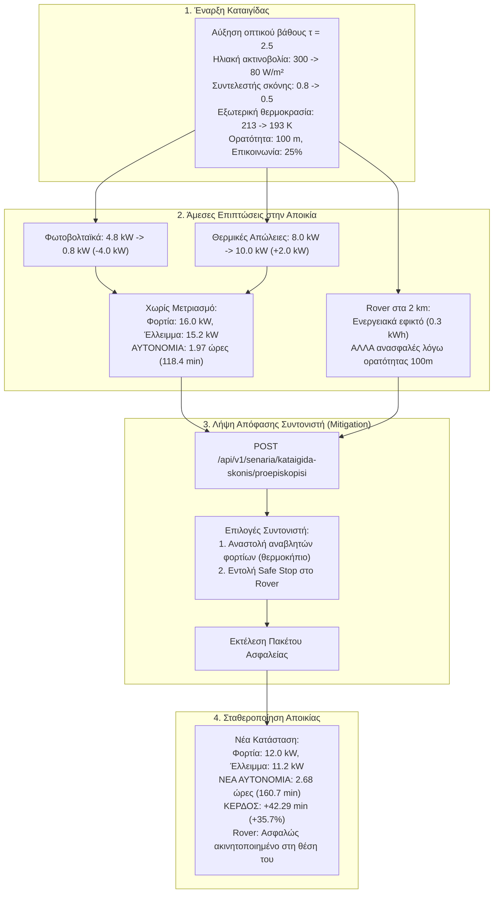

# 06 - Περιγραφή Σεναρίων Προσομοίωσης

Το σύστημα περιλαμβάνει 4 προκαθορισμένα σενάρια ελέγχου και επικύρωσης.

---

## 1. Σενάριο Βασικής Κατάστασης (Baseline Scenario)
- **Συνθήκες Περιβάλλοντος:**
  - Εξωτερική θερμοκρασία: $213 \, K$ ($-60.15^\circ C$).
  - Ηλιακή ακτινοβολία: $300 \, W/m^2$.
  - Συντελεστής σκόνης: $0.80$.
- **Λειτουργία Αποικίας:**
  - Εσωτερική θερμοκρασία θαλάμων: $293 \, K$ ($+19.85^\circ C$).
  - Θερμικές απώλειες: $8.0 \, kW$.
  - Φωτοβολταϊκή παραγωγή: $4.8 \, kW$.
  - Συνολικό φορτίο: $14.0 \, kW$ (10 kW βασικό + 4 kW αναβλητό).
  - Έλλειμμα ισχύος: $9.2 \, kW$.
  - Ενεργειακή αυτονομία αποικίας: $3.26 \, h$ (με μπαταρία 30 kWh).
  - Rover σε αποστολή: 2 km από τη βάση, μπαταρία 0.8 kWh, ορατότητα 1500 m, επικοινωνία 95%.
- **Στόχος:** Παρέχει την κανονική βάση εκκίνησης και ομαλής λειτουργίας.

---

## 2. Σενάριο Καταιγίδας Σκόνης (Dust Storm Golden Scenario)

### Διάγραμμα Ροής Σεναρίου Καταιγίδας

- **Εξέλιξη Συμβάντος:**
  - Μεγάλης κλίμακας αρειανή αμμοθύελλα.
  - Το οπτικό βάθος ($\tau$) αυξάνεται, μειώνοντας την ηλιακή ακτινοβολία στα $80 \, W/m^2$ και τον συντελεστή σκόνης στο $0.50$.
  - Η εξωτερική θερμοκρασία πέφτει στους $193 \, K$ ($-80.15^\circ C$).
  - Η ορατότητα πέφτει στα $100 \, m$ και η ποιότητα επικοινωνίας rover πέφτει στο $25\%$.
- **Επιπτώσεις στην Αποικία:**
  - Η φωτοβολταϊκή παραγωγή κατακρημνίζεται στα **$0.8 \, kW$** (πτώση $4.0 \, kW$).
  - Οι θερμικές απώλειες αυξάνονται στα **$10.0 \, kW$** (αύξηση $+2.0 \, kW$).
  - Χωρίς περιορισμό φορτίων, το έλλειμμα φτάνει στα **$15.2 \, kW$** και η αυτονομία πέφτει στις **$1.97 \, h$**.
- **Μέτρα Αντιμετώπισης (Mitigation):**
  - Αναστολή αναβλητών φορτίων (θέρμανση θερμοκηπίου $4.0 \, kW \to 0 \, kW$).
  - Το συνολικό φορτίο διαμορφώνεται στα $12.0 \, kW$, το έλλειμμα στα $11.2 \, kW$, και η αυτονομία αυξάνεται στις **$2.68 \, h$** (**κέρδος $+42.29 \, \text{λεπτά}$**).
  - Το rover λαμβάνει εντολή Safe Stop (ασφαλής ακινητοποίηση) αντί για ριψοκίνδυνη επιστροφή.

---

## 3. Σενάριο Έκτακτης Επιστροφής Rover (Rover Emergency Scenario)
- Το rover βρίσκεται στα $2.0 \, km$ εκτελώντας δειγματοληψία.
- Εντοπίζεται ταχεία επιδείνωση καιρού.
- Ο υπολογισμός ενέργειας δείχνει ότι η μπαταρία ($0.8 \, kWh$) επαρκεί για την απαιτούμενη ενέργεια ($0.3 \, kWh$), αφήνοντας $0.5 \, kWh > 0.2 \, kWh$ αποθεματικό.
- Ωστόσο, η χαμηλή ορατότητα ($100 \, m < 300 \, m$) και η υποβάθμιση του σήματος καθιστούν την οδήγηση επιστροφής υψηλού κινδύνου.
- Το σύστημα προτείνει και εκτελεί εντολή **Safe Stop**, ακινητοποιώντας το όχημα σε ασφαλή γεωμετρία.

---

## 4. Σενάριο Διαρροής Ατμόσφαιρας Θαλάμου (ECLSS Cabin Leak)
- Προσομοίωση απότομης πτώσης πίεσης σε θάλαμο διαμονής (από 101.3 kPa σε < 85 kPa).
- Άμεση έκδοση συναγερμού κρίσιμης σοβαρότητας (`krisimi`).
- Αυτόματη απομόνωση θυρίδων και ενεργοποίηση συμπληρωματικής παροχής οξυγόνου.
- Αναγνώριση (`anagnwrisi`) από τον υπεύθυνο υποστήριξης ζωής και μετάβαση σε πρωτόκολλο αποκατάστασης.
