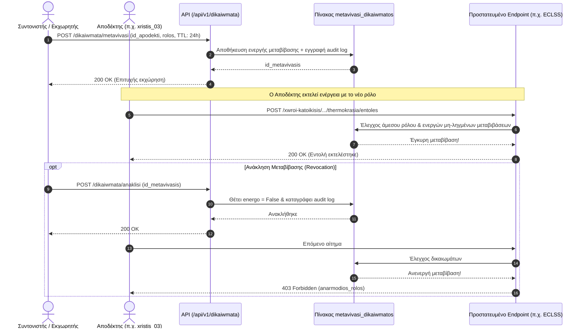

# 08 - Ρόλοι Χρηστών, Ασφάλεια και Μεταβίβαση Δικαιωμάτων

## 1. Μοντέλο Ελέγχου Πρόσβασης (RBAC)
Το σύστημα υλοποιεί έλεγχο πρόσβασης βάσει ρόλων (Role-Based Access Control) με 4 διακριτούς ρόλους:

| Ρόλος (Greeklish) | Περιγραφή | Αρμοδιότητες & Δικαιώματα |
| :--- | :--- | :--- |
| `syntonistis_apoikias` | Συντονιστής Αποικίας | Καθολική εποπτεία, ενεργοποίηση σεναρίων έκτακτης ανάγκης, έγκριση μεταβιβάσεων δικαιωμάτων. |
| `ypefthynos_ypostiriksis_zwis` | Υπεύθυνος Υποστήριξης Ζωής | Διαχείριση κλίματος θαλάμων, ρύθμιση θερμοκρασίας, ανακύκλωση αέρα, διαχείριση οξυγόνου. |
| `ypefthynos_porwn` | Υπεύθυνος Πόρων & Ενέργειας | Διαχείριση υδατικών πόρων, άρδευση θερμοκηπίων, περιορισμός φορτίων, παρακολούθηση μπαταριών. |
| `xeiristis_oximatos` | Χειριστής Οχήματος / Rover | Τηλεμετρία rover, σχεδιασμός πορείας, εντολή ασφαλούς στάθμευσης, επίβλεψη αποστολών. |

---

## 2. Επικεφαλίδες Ταυτοποίησης (HTTP Headers)
Σε κάθε εισερχόμενη κλήση API απαιτούνται οι εξής επικεφαλίδες:
- `X-ID-Xristi`: Το αναγνωριστικό του χρήστη (π.χ. `xristis_01`).
- `X-Rolos`: Ο ρόλος με τον οποίο εκτελείται το αίτημα (π.χ. `ypefthynos_ypostiriksis_zwis`).

Εάν ο χρήστης δεν διαθέτει τον απαιτούμενο ρόλο για τη συγκεκριμένη διαδρομή, το σύστημα ελέγχει αν υπάρχει ενεργή και έγκυρη μεταβίβαση δικαιώματος. Αν όχι, επιστρέφεται κωδικός `403 Forbidden` με μήνυμα `sfalma: {kodikos: "anarmodios_rolos", ...}`.

---

## 3. Μεταβίβαση Δικαιωμάτων (Role Delegation)

### Διάγραμμα Ροής Μεταβίβασης & Ελέγχου Δικαιωμάτων

Σε περιπτώσεις ανάπαυσης, έκτακτης ανάγκης ή κωλύματος:
1. Ένας χρήστης (ή ο Συντονιστής) μπορεί να εκχωρήσει προσωρινά έναν ρόλο σε άλλον χρήστη (`POST /api/v1/dikaiwmata/metavivasi`).
2. Η μεταβίβαση περιλαμβάνει:
   - `id_ekxwriti`: Ποιος εκχωρεί.
   - `id_apodekti`: Ποιος λαμβάνει το δικαίωμα.
   - `rolos`: Ο μεταβιβαζόμενος ρόλος.
   - `xronos_liksis`: Χρονικό όριο ισχύος (TTL).
   - `aitiologia`: Αιτιολογία εκχώρησης.
3. Η μεταβίβαση μπορεί να ανακληθεί ανά πάσα στιγμή από τον εκχωρητή ή τον συντονιστή (`POST /api/v1/dikaiwmata/anaklisi`).
4. Οι ελεγκτές ασφαλείας επικυρώνουν τόσο τον άμεσο ρόλο όσο και τις ενεργές μη-ληγμένες μεταβιβάσεις.

---

## 4. Αρχείο Καταγραφής Ελέγχου (Audit Log)
- Κάθε τροποποίηση κατάστασης, επιβεβαίωση εντολής, ρύθμιση παραμέτρου ή μεταβίβαση δικαιώματος καταγράφεται στον πίνακα `katagrafi_elegxou`.
- Καταγράφονται:
  - `id_xristi`: Χρήστης που πραγματοποίησε την ενέργεια.
  - `drasi`: Η ακριβής δράση (π.χ. `epivevaiwsi_ardefsis`, `safe_stop_rover`).
  - `yposystima`: Το επηρεαζόμενο υποσύστημα.
  - `leptomereies`: Πλήρη δεδομένα παραμέτρων και αποτελέσματος σε μορφή JSON.
  - `xronos_katagrafis`: Χρονοσφραγίδα σε UTC.
- Η πρόσβαση στο ιστορικό καταγραφών ελέγχου παρέχεται μέσω του endpoint `/api/v1/istoriko-elegxou`.
