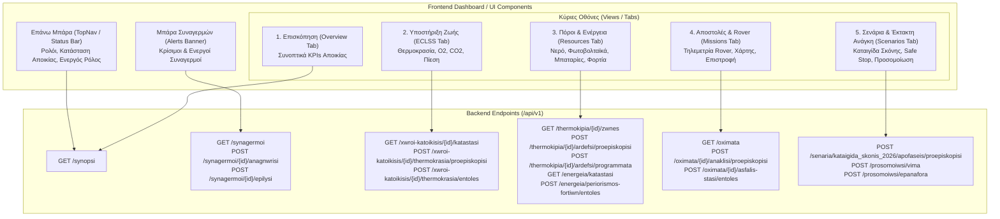
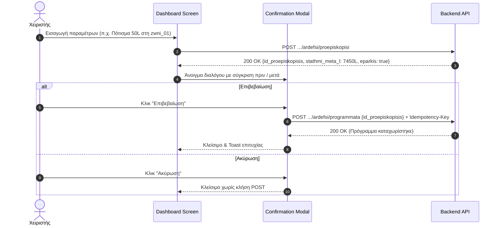

# 11 - Οδηγός Παράδοσης προς τον Συνεργάτη Frontend

Αγαπητή συνάδελφε του Frontend,

Το backend του **Smart Mars Colony** είναι πλήρως έτοιμο, επαληθευμένο και διαθέσιμο για άμεση ενσωμάτωση. Παρακάτω παρατίθενται αναλυτικές οδηγίες, διαγράμματα αρχιτεκτονικής UI και η αντιστοίχιση των οθονών του Dashboard με τα endpoints μας.

---

## 1. Αρχιτεκτονική Διασύνδεσης Dashboard & API



---

## 2. Βασικές Συμβάσεις Επικοινωνίας

1. **Βάση URL:** Όλα τα endpoints βρίσκονται υπό το πρόθεμα `/api/v1`.
2. **Επικεφαλίδες Ταυτοποίησης (Headers):**
   Κάθε κλήση πρέπει να περιλαμβάνει:
   ```http
   X-ID-Xristi: <id_xristi>
   X-Rolos: <rolos>
   ```
   *Προεπιλεγμένοι λογαριασμοί επίδειξης (Seed Accounts):*
   - `xristis_zwis` με ρόλο `ypefthynos_ypostiriksis_zwis` (Κλίμα / Θερμοκρασία / Ατμόσφαιρα)
   - `xristis_porwn` με ρόλο `ypefthynos_porwn` (Νερό / Άρδευση / Ενέργεια)
   - `xristis_apostolwn` με ρόλο `ypefthynos_apostolwn` (Rover / Αποστολές)
   - `syntonistis` με ρόλο `syntonistis_apoikias` (Συντονιστής Αποικίας / Έκτακτα Σενάρια)
3. **Κανόνας Greeklish (§0A):**
   - Όλα τα JSON κλειδιά και οι τιμές παραμέτρων είναι σε ASCII Greeklish (π.χ. `posotita_nerou_l`, `thermokrasia_k`, `katastasi`).
   - Μην χρησιμοποιείτε αγγλικούς όρους όπως `water_liters` ή `status` στα αιτήματα.

---

## 3. Το Μοτίβο Δύο Βημάτων (Preview -> Confirm / Cancel)



---

## 4. Διαχείριση Σφαλμάτων (Unified Error Envelope)

Σε περίπτωση σφάλματος (HTTP 400, 403, 404, 409, 422, 500), η απόκριση έχει πάντα τη μορφή:
```json
{
  "sfalma": {
    "kodikos": "ANEPARKES_NERO",
    "minyma": "Το διαθέσιμο νερό πάνω από την εφεδρεία δεν επαρκεί για την άρδευση.",
    "leptomereies": {
      "diathesimo_l": 6000.0,
      "zitoumeno_l": 10000.0,
      "efedreia_asfaleias_l": 1500.0
    },
    "id_aitimatos": null,
    "epanalipsimo": false
  }
}
```
Μπορείτε να εμφανίζετε απευθείας το πεδίο `minyma` στον χρήστη στο UI, καθώς είναι γραμμένο στα ελληνικά.

---

## 5. Αντιστοίχιση Οθονών & Χρήσιμα Endpoints

| Οθόνη UI | Σκοπός | Κύριο Endpoint | Δευτερεύοντα Endpoints |
| :--- | :--- | :--- | :--- |
| **Επισκόπηση (Overview)** | Συνοπτική εικόνα KPIs | `GET /api/v1/synopsi` | `GET /api/v1/synagermoi` |
| **Θάλαμοι (ECLSS)** | Έλεγχος & ρύθμιση κλίματος | `GET /api/v1/xwroi-katoikisis/xwros_01/katastasi` | `POST .../thermokrasia/proepiskopisi`<br/>`POST .../thermokrasia/entoles` |
| **Θερμοκήπια & Νερό** | Ζώνες φυτών & άρδευση | `GET /api/v1/thermokipia/thermokipio_01/zwnes` | `POST .../ardefsi/proepiskopisi`<br/>`POST .../ardefsi/programmata` |
| **Ενέργεια & Φορτία** | Ηλεκτρικό ισοζύγιο & περικοπές | `GET /api/v1/energeia/katastasi` | `POST /api/v1/energeia/periorismos-fortiwn/entoles` |
| **Rover & EVA** | Τηλεμετρία & ασφαλής στάση | `GET /api/v1/oximata` | `POST .../anaklisi/proepiskopisi`<br/>`POST .../asfalis-stasi/entoles` |
| **Σενάριο Καταιγίδας** | Προσομοίωση αμμοθύελλας | `POST /api/v1/senaria/kataigida_skonis_2026/apofaseis/proepiskopisi` | `POST /api/v1/prosomoiwsi/vima`<br/>`POST /api/v1/prosomoiwsi/epanafora` |
| **Ιστορικό Ελέγχου** | Audit log ενεργειών | `GET /api/v1/istoriko-elegxou` | `GET /api/v1/dikaiwmata/metavivaseis` |
