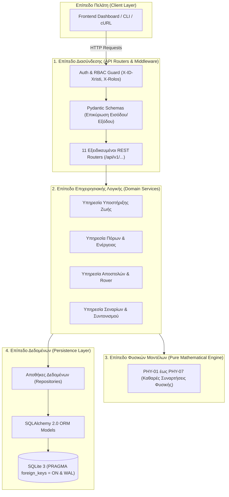
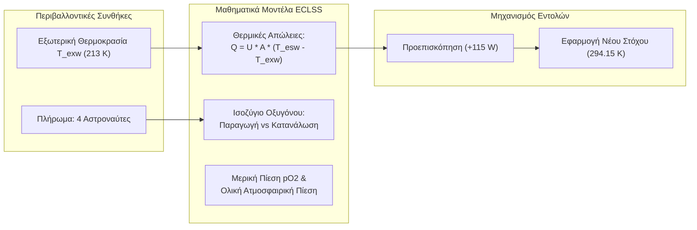
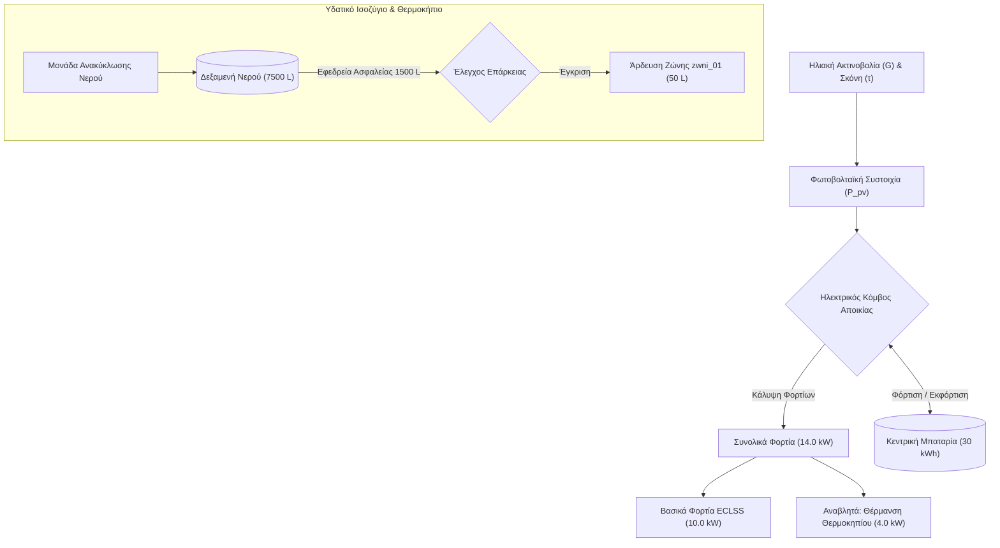
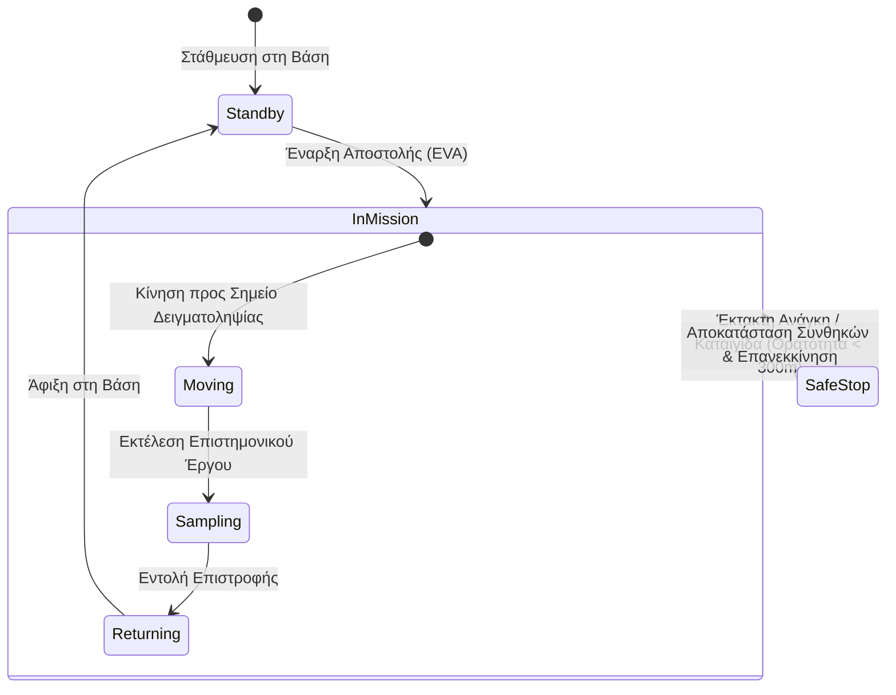
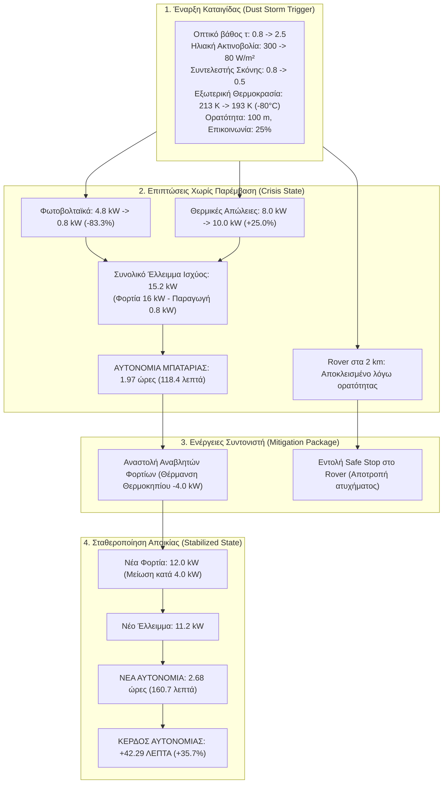
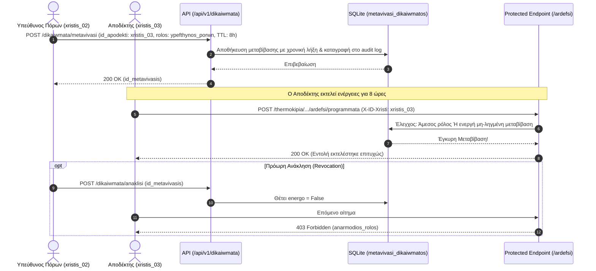
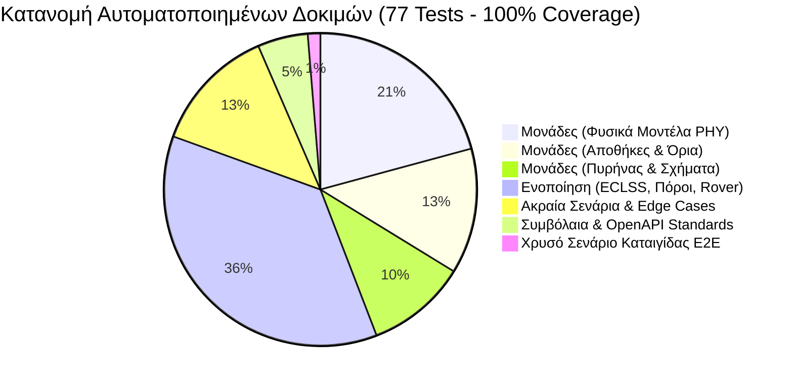

# Smart Mars Colony — Παρουσίαση Αρχιτεκτονικής & Υλοποίησης Backend
### Ακαδημαϊκή Έκθεση & Οδηγός Showcase (Ακαδημαϊκό Έτος 2026–2027)

> [!IMPORTANT]
> **Κεντρική Πύλη Παρουσίασης & Τεκμηρίωσης (Showcase Hub):**
> Το παρόν αρχείο αποτελεί την επίσημη, ολοκληρωμένη παρουσίαση του υπολογιστικού πυρήνα (backend) του έργου **Smart Mars Colony**. Είναι σχεδιασμένο τόσο ως αυτοτελής παρουσίαση (Slide-by-Slide) για την εξέταση του μαθήματος και την αξιολόγηση από τους διδάσκοντες, όσο και ως κεντρικός κόμβος υποδοχής (Handoff Hub) για τη φοιτήτρια που αναλαμβάνει την ανάπτυξη του Frontend UI.

---

## Περιεχόμενα Παρουσίασης (Slide Index)

| Διαφάνεια / Ενότητα | Τίτλος Θέματος | Κύριο Περιεχόμενο |
| :---: | :--- | :--- |
| **Slide 1** | [Ταυτότητα Έργου & Όραμα](#slide-1--ταυτότητα-έργου--όραμα) | Αποστολή, εκπαιδευτικό πλαίσιο, 4 αρχές σχεδιασμού |
| **Slide 2** | [Αρχιτεκτονική Πυρήνα & Stack](#slide-2--αρχιτεκτονική-πυρήνα--τεχνολογικό-stack) | FastAPI, SQLite FKs, Pydantic v2, Alembic, Greeklish §0A |
| **Slide 3** | [Υποσύστημα Α: Υποστήριξη Ζωής (ECLSS)](#slide-3--υποσύστημα-α-υποστήριξη-ζωής-eclss) | Θερμικό ισοζύγιο, $O_2$, $pO_2$, πίεση, διφασική ρύθμιση |
| **Slide 4** | [Υποσύστημα Β: Πόροι & Ενέργεια](#slide-4--υποσύστημα-β-πόροι--ενέργεια) | Φωτοβολταϊκά, μπαταρία, υδατικό ισοζύγιο, αναστολή φορτίων |
| **Slide 5** | [Υποσύστημα Γ: Αποστολές & Rover](#slide-5--υποσύστημα-γ-αποστολές--rover) | Κινηματική, ενεργειακή αυτονομία, Safe Stop, κίνδυνος |
| **Slide 6** | [Το Χρυσό Σενάριο Καταιγίδας (Golden Scenario)](#slide-6--το-χρυσό-σενάριο-καταιγίδας-golden-scenario) | Αλυσίδα γεγονότων: 4.8 kW $\to$ 0.8 kW, κέρδος +42.29 min |
| **Slide 7** | [Ασφάλεια, RBAC & Μεταβίβαση Δικαιωμάτων](#slide-7--ασφάλεια-rbac--μεταβίβαση-δικαιωμάτων) | 4 Ρόλοι, delegation με TTL, Idempotency-Key, Audit Trail |
| **Slide 8** | [Σενάριο Ζωντανής Επίδειξης (Live Demo Script)](#slide-8--σενάριο-ζωντανής-επίδειξης-live-demo-script) | 3 δοκιμασμένες εντολές cURL (Θερμοκρασία, Άρδευση, Σφάλμα) |
| **Slide 9** | [Handoff προς το Frontend & Αρχές HCI](#slide-9--handoff-προς-το-frontend--αρχές-hci) | Συμβόλαια `docs/koino/`, error envelopes, HTA & 7 στάδια Norman |
| **Slide 10** | [Δοκιμές, Κάλυψη & Ποιοτικός Έλεγχος](#slide-10--δοκιμές-κάλυψη--ποιοτικός-έλεγχος) | 77/77 (100%) επιτυχία, 100% κάλυψη (0 missing), Ruff clean |
| **Παράρτημα** | [Πλήρες Ευρετήριο Τεκμηρίωσης (Sitemap)](#παράρτημα-πλήρες-ευρετήριο-τεκμηρίωσης-sitemap) | Σύνδεσμοι προς όλα τα έγγραφα `docs/backend/00..17` |

---

## Slide 1 / Ταυτότητα Έργου & Όραμα

### 1.1 Η Εκπαιδευτική Αποστολή (Academic Mission 2026–2027)
Η διαβίωση σε ένα αφιλόξενο περιβάλλον όπως ο πλανήτης Άρης απαιτεί απόλυτο έλεγχο, ντετερμινιστική απόκριση και μηδενική ανοχή σε ανεξέλεγκτα σφάλματα. Το **Smart Mars Colony** υλοποιήθηκε ως υπολογιστικός πυρήνας (backend simulation engine) υψηλής πιστότητας, συνδυάζοντας:
- **Μηχανική Λογισμικού (Software Engineering):** Πολυεπίπεδη αρχιτεκτονική, αυστηρή τυποποίηση REST API, αμετάβλητο ιστορικό ελέγχου (audit log) και διαχείριση ταυτοχρονισμού.
- **Αλληλεπίδραση Ανθρώπου-Υπολογιστή (HCI):** Σχεδιασμός με βάση τα 7 Στάδια Δράσης του Don Norman και την Ιεραρχική Ανάλυση Εργασιών (HTA), αποτρέποντας ανθρώπινα λάθη μέσω του μοτίβου δύο φάσεων (Preview / Confirm).
- **Εφαρμοσμένη Φυσική & Μηχανική:** Ντετερμινιστικά μαθηματικά μοντέλα θερμοδυναμικής, ηλιακής ακτινοβολίας, ατμοσφαιρικής χημείας και κινηματικής οχημάτων.

```
       ┌────────────────────────────────────────────────────────┐
       │             SMART MARS COLONY ECOSYSTEM                │
       └───────────────────────────┬────────────────────────────┘
                                   │
         ┌─────────────────────────┼─────────────────────────┐
         ▼                         ▼                         ▼
  Υποσύστημα Α              Υποσύστημα Β              Υποσύστημα Γ
Υποστήριξη Ζωής            Πόροι & Ενέργεια          Αποστολές & Rover
    (ECLSS)               (Power & Resources)             (EVA)
 • Θερμοκρασία             • Φωτοβολταϊκά            • Τηλεμετρία
 • Οξυγόνο / CO2           • Μπαταρίες Αποικίας      • Ενέργεια Κίνησης
 • Ατμοσφαιρική Πίεση      • Υδατικό Ισοζύγιο        • Πρωτόκολλο Safe Stop
 • Θάλαμοι Διαμονής        • Έξυπνη Άρδευση          • Διαχείριση Κινδύνου
```

### 1.2 Τέσσερις Θεμελιώδεις Αρχές Σχεδιασμού

> [!NOTE]
> 1. **Αμιγή Φυσικά Μοντέλα (Pure Physics Functions):** Όλες οι εξισώσεις φυσικής είναι υλοποιημένες ως καθαρές συναρτήσεις (deterministic, zero side-effects). Δεν εξαρτώνται από τη βάση δεδομένων ή το web framework, καθιστώντας τις 100% ελέγξιμες και επαναχρησιμοποιήσιμες.
> 2. **Μοτίβο Δύο Φάσεων (Preview $\to$ Confirm / Cancel):** Καμία κρίσιμη ενέργεια (τροποποίηση θερμοκρασίας, δέσμευση νερού, κίνηση rover) δεν εκτελείται απευθείας. Ο χειριστής λαμβάνει πρώτα προεπισκόπηση των επιπτώσεων (π.χ. μεταβολή σε Watts ή Λίτρα) και αποφασίζει ρητά.
> 3. **Ασφάλεια Πρώτης Γραμμής (Defense-in-Depth):** Αυστηρός έλεγχος πρόσβασης βάσει ρόλων (RBAC), μεταβίβαση δικαιωμάτων με χρονικό περιορισμό (TTL delegation) και προστασία διπλοεγγραφών με κλειδιά μοναδικότητας (`Idempotency-Key`).
> 4. **Απόλυτη Ιχνηλασιμότητα (Complete Traceability):** Κάθε απόφαση, μεταβολή παραμέτρου ή σφάλμα καταγράφεται σε αμετάβλητο πίνακα ιστορικού ελέγχου (`katagrafi_elegxou`), εξασφαλίζοντας πλήρη λογοδοσία.

---

## Slide 2 / Αρχιτεκτονική Πυρήνα & Τεχνολογικό Stack

### 2.1 Πολυεπίπεδη Αρχιτεκτονική (Layered Architecture)
Το backend ακολουθεί αυστηρή αποσύνδεση ευθυνών σε 4 βασικά επίπεδα:



### 2.2 Τεχνολογικό Stack & Εργαλεία

| Τομέας | Τεχνολογία | Αιτιολόγηση Επιλογής |
| :--- | :--- | :--- |
| **Γλώσσα** | Python 3.12+ | Υψηλή αναγνωσιμότητα, πλούσιο οικοσύστημα επιστημονικών βιβλιοθηκών, type hinting |
| **Web Framework** | FastAPI | Ασύγχρονο, υψηλής απόδοσης, αυτόματη παραγωγή OpenAPI 3.1 & Swagger UI |
| **Επικύρωση Δεδομένων** | Pydantic v2 | Ταχύτατη επικύρωση τύπων και ορίων, αυτόματος μετασχηματισμός DTOs |
| **Βάση Δεδομένων** | SQLite 3 | Ενσωματωμένη, μηδενικές εξωτερικές απαιτήσεις, υποστήριξη συναλλαγών ACID |
| **ORM & Migrations** | SQLAlchemy 2.0 + Alembic | Αυστηρό σχήμα, ξένα κλειδιά, πλήρης διαχείριση μεταναστεύσεων |
| **Έλεγχος Ποιότητας** | pytest, pytest-cov, Ruff | Αυτοματοποιημένες δοκιμές μονάδας και ενοποίησης, ταχύτατο linting/formatting |

### 2.3 Ο Χρυσός Κανόνας Ονοματοδοσίας Greeklish (§0A)
Για τη διασφάλιση απόλυτης συνέπειας χωρίς προβλήματα κωδικοποίησης χαρακτήρων σε ποικίλα περιβάλλοντα:
- **Όλα τα αναγνωριστικά κώδικα:** Συναρτήσεις (`ypologise_thermikes_apwleies`), κλάσεις (`AitimaProepiskopisis`), πεδία JSON (`epithymiti_thermokrasia_k`), πίνακες βάσης (`metavivasi_dikaiwmatos`) και διαδρομές API (`/api/v1/xwroi-katoikisis`) γράφονται αποκλειστικά σε **Greeklish (ASCII)**.
- **Όλη η τεκμηρίωση:** Επεξηγήσεις, markdown αρχεία, docstrings και μηνύματα σφαλμάτων προς τον χρήστη γράφονται με άρτια, φυσική **Ελληνική γλώσσα (UTF-8)**.

---

## Slide 3 / Υποσύστημα Α: Υποστήριξη Ζωής (ECLSS)

### 3.1 Αποστολή & Πεδίο Ελέγχου
Το υποσύστημα ECLSS διαχειρίζεται το εσωτερικό περιβάλλον των θαλάμων διαβίωσης (`xwroi_katoikisis`), εξασφαλίζοντας σταθερή θερμοκρασία, αναπνεύσιμη ατμόσφαιρα και ασφαλή πίεση.



### 3.2 Επιστημονικές Εξισώσεις Υποσυστήματος
1. **Θερμικές Απώλειες Κελύφους (PHY-01):**
   $$Q_{loss} = U \cdot A \cdot (T_{esw} - T_{exw})$$
   - $U = 0.2 \, W/(m^2 \cdot K)$ (Συντελεστής θερμοπερατότητας μόνωσης)
   - $A = 500.0 \, m^2$ (Επιφάνεια κελύφους θαλάμου)
   - $T_{esw} = 293.15 \, K$ ($+20^\circ C$), $T_{exw} = 213.15 \, K$ ($-60^\circ C$) $\implies Q_{loss} = 8.0 \, kW$.
2. **Μερική Πίεση Οξυγόνου (PHY-02):**
   $$pO_2 = P_{total} \cdot f_{O_2}$$
   - Όριο ασφαλείας: $19.5 \, kPa \le pO_2 \le 23.5 \, kPa$ (Ονομαστική τιμή: $21.3 \, kPa$).
3. **Αυτονομία Αποθέματος Οξυγόνου (PHY-04):**
   $$t_{autonomia} = \frac{M_{O_2}}{N_{crew} \cdot r_{cons} - r_{prod}}$$

### 3.3 Διφασική Ρύθμιση Θερμοκρασίας
Όταν ο υπεύθυνος υποστήριξης ζωής επιθυμεί να αλλάξει τη θερμοκρασία:
- **Φάση 1 (Preview):** Καλεί `POST /api/v1/xwroi-katoikisis/{id}/thermokrasia/proepiskopisi`. Το σύστημα υπολογίζει ότι η αύξηση κατά $+1.15 \, K$ απαιτεί $+115 \, W$ επιπλέον ισχύ θέρμανσης και επιστρέφει διαγνωστικό δελτίο.
- **Φάση 2 (Confirm):** Αν ο χειριστής συναινέσει, καλεί `POST /api/v1/xwroi-katoikisis/{id}/thermokrasia/entoles` με `Idempotency-Key`. Η εντολή εφαρμόζεται και καταγράφεται στο audit log.

---

## Slide 4 / Υποσύστημα Β: Πόροι & Ενέργεια

### 4.1 Ενεργειακό & Υδατικό Δίκτυο Αποικίας
Η επιβίωση στον Άρη εξαρτάται από τον άμεσο συντονισμό παραγωγής ενέργειας, διαχείρισης μπαταριών, ανακύκλωσης νερού και γεωργικής παραγωγής.



### 4.2 Φυσικά Μοντέλα Ενέργειας & Πόρων
1. **Φωτοβολταϊκή Παραγωγή (PHY-03):**
   $$P_{pv} = A_{pv} \cdot \eta_{pv} \cdot G \cdot \eta_{dust}$$
   - $A_{pv} = 80 \, m^2$, $\eta_{pv} = 0.25$, $G = 300 \, W/m^2$, $\eta_{dust} = 0.80 \implies P_{pv} = 4.8 \, kW$.
2. **Ηλεκτρικό Ισοζύγιο & Αυτονομία Μπαταρίας (PHY-05):**
   $$P_{deficit} = \max(0, P_{load} - P_{pv}), \quad t_{autonomia} = \frac{E_{battery}}{P_{deficit}}$$
   - Στην κανονική λειτουργία: $P_{load} = 14.0 \, kW$, $P_{pv} = 4.8 \, kW \implies P_{deficit} = 9.2 \, kW$.
   - Με μπαταρία $30 \, kWh$: $t_{autonomia} = 30 / 9.2 \approx 3.26 \, \text{ώρες}$ ($195.6 \, \text{λεπτά}$).
3. **Υδατικό Ισοζύγιο & Εφεδρεία Ασφαλείας (PHY-07):**
   - Η δεξαμενή διαθέτει απόθεμα $7.500 \, L$ με αδιαπραγμάτευτο όριο ασφαλείας $1.500 \, L$.
   - Οποιοδήποτε αίτημα άρδευσης που θα παραβίαζε το όριο (π.χ. αίτημα $10.000 \, L$) απορρίπτεται άμεσα με σφάλμα `ANEPARKES_NERO` πριν από οποιαδήποτε εγγραφή στη βάση.

---

## Slide 5 / Υποσύστημα Γ: Αποστολές & Rover

### 5.1 Τηλεμετρία & Διαχείριση Κινδύνου Επιφανείας
Το rover εξερεύνησης εκτελεί εξωτερικές αποστολές (EVA) συλλογής δειγμάτων. Το backend παρακολουθεί σε πραγματικό χρόνο:
- Συντεταγμένες θέσης $(x, y)$ και απόσταση από τη βάση ($d$).
- Ταχύτητα κίνησης ($v$), κλίση εδάφους ($\theta$) και κατανάλωση ισχύος έλξης ($P_{traction}$).
- Επίπεδο φόρτισης μπαταρίας ($E_{bat}$ σε $kWh$).
- Περιβαλλοντικές συνθήκες: Οπτική ορατότητα ($m$) και ποιότητα ζεύξης τηλεπικοινωνιών ($\%$).



### 5.2 Κριτήρια Ασφαλούς Επιστροφής vs Ασφαλούς Στάσης (PHY-06)
1. **Απαιτούμενη Ενέργεια Επιστροφής:**
   $$E_{trip} = \left(\frac{d}{v}\right) \cdot P_{traction} \cdot (1 + \sin\theta) \cdot \frac{1}{3.6 \times 10^6}$$
   - Για απόσταση $d = 2.0 \, km$, $v = 1.0 \, m/s$, $P_{traction} = 540 \, W \implies E_{trip} \approx 0.3 \, kWh$.
2. **Λήψη Απόφασης Ασφαλείας:**
   - Εάν η μπαταρία του rover είναι $0.8 \, kWh$, το ενεργειακό απόθεμα επαρκεί ($0.8 - 0.3 = 0.5 \, kWh > 0.2 \, kWh$ περιθώριο).
   - **Ωστόσο**, εάν η ορατότητα πέσει στα $100 \, m$ ($< 300 \, m$) ή η επικοινωνία υποβαθμιστεί στο $25\%$ ($< 50\%$), ο αλγόριθμος κρίνει την κίνηση **εξαιρετικά επικίνδυνη**.
   - Το σύστημα απορρίπτει την επιστροφή και εκδίδει εντολή **Safe Stop** (ασφαλής ακινητοποίηση οχήματος, διατήρηση βασικών αισθητήρων και αναμονή εξασθένησης της καταιγίδας).

---

## Slide 6 / Το Χρυσό Σενάριο Καταιγίδας (Golden Scenario)

### 6.1 Η Μεγάλη Αρειανο-Καταιγίδα: Αλυσίδα Επιπτώσεων
Το ολοκληρωμένο σενάριο ελέγχου προσομοιώνει την εκδήλωση σφοδρής αμμοθύελλας στον Άρη και αναδεικνύει την αλληλεξάρτηση όλων των υποσυστημάτων.



### 6.2 Αριθμητική Σύγκριση Καταστάσεων

| Παράμετρος | 1. Κανονική (Baseline) | 2. Καταιγίδα (Χωρίς Μετριασμό) | 3. Καταιγίδα (Μετά τον Μετριασμό) | Μεταβολή (3 vs 2) |
| :--- | :---: | :---: | :---: | :---: |
| **Ηλιακή Ακτινοβολία** | $300 \, W/m^2$ | $80 \, W/m^2$ | $80 \, W/m^2$ | — |
| **Εξωτερική Θερμοκρασία** | $213 \, K$ ($-60.15^\circ C$) | $193 \, K$ ($-80.15^\circ C$) | $193 \, K$ ($-80.15^\circ C$) | — |
| **Παραγωγή Φωτοβολταϊκών** | $4.80 \, kW$ | **$0.80 \, kW$** | $0.80 \, kW$ | $0.0 \, kW$ |
| **Θερμικές Απώλειες Θαλάμων** | $8.00 \, kW$ | **$10.00 \, kW$** | $10.00 \, kW$ | $0.0 \, kW$ |
| **Αναβλητά Φορτία (Θερμοκήπιο)**| $4.00 \, kW$ | $4.00 \, kW$ | **$0.00 \, kW$ (Αναστολή)** | **$-4.00 \, kW$** |
| **Συνολικό Φορτίο Αποικίας** | $14.00 \, kW$ | $16.00 \, kW$ | **$12.00 \, kW$** | **$-4.00 \, kW$** |
| **Έλλειμμα Ισχύος** | $9.20 \, kW$ | $15.20 \, kW$ | **$11.20 \, kW$** | **$-4.00 \, kW$** |
| **Αυτονομία Μπαταρίας (30 kWh)**| $3.26 \, h$ ($195.6 \, m$) | **$1.97 \, h$ ($118.4 \, m$)** | **$2.68 \, h$ ($160.7 \, m$)** | **$+42.29 \, \text{λεπτά}$** |
| **Κατάσταση Rover** | Σε Κίνηση (2 km) | Κρίσιμη Ορατότητα ($100 m$) | **Safe Stop (Ασφαλής Στάση)**| Αποτροπή Συντριβής |

---

## Slide 7 / Ασφάλεια, RBAC & Μεταβίβαση Δικαιωμάτων

### 7.1 Μοντέλο Ελέγχου Πρόσβασης (RBAC - 4 Ρόλοι)
Το API προστατεύει κάθε λειτουργία ανάλογα με τον ρόλο του χρήστη:

| Ρόλος (Greeklish) | Τίτλος Ρόλου | Δικαιώματα & Αρμοδιότητες |
| :--- | :--- | :--- |
| `syntonistis_apoikias` | Συντονιστής Αποικίας | Καθολική εποπτεία, εκτέλεση σεναρίων κρίσης, έγκριση μεταβίβασης δικαιωμάτων |
| `ypefthynos_ypostiriksis_zwis` | Υπεύθυνος ECLSS | Ρύθμιση θερμοκρασίας θαλάμων, ανακύκλωση αέρα, διαχείριση $O_2$ |
| `ypefthynos_porwn` | Υπεύθυνος Πόρων | Άρδευση θερμοκηπίου, κατανομή νερού, περιορισμός αναβλητών φορτίων |
| `xeiristis_oximatos` | Χειριστής Rover | Παρακολούθηση τηλεμετρίας rover, σχεδιασμός πορείας, εντολή Safe Stop |

### 7.2 Μηχανισμός Μεταβίβασης Δικαιωμάτων (Role Delegation with TTL)
Όταν ένας υπεύθυνος πρέπει να αναπαυθεί ή απουσιάζει, μπορεί να εκχωρήσει προσωρινά τα δικαιώματά του:



### 7.3 Προστασία Διπλοεγγραφών & Αμετάβλητο Audit Log
- **Κλειδί Μοναδικότητας (`Idempotency-Key`):** Σε αναξιόπιστες συνδέσεις (όπως η επικοινωνία με μακρινούς σταθμούς), ο πελάτης στέλνει ένα UUID header. Εάν το δίκτυο διακοπεί και το αίτημα επαναληφθεί, το backend αναγνωρίζει το κλειδί και επιστρέφει το αρχικό αποτέλεσμα χωρίς διπλή χρέωση πόρων.
- **Αρχείο Καταγραφής Ελέγχου (`katagrafi_elegxou`):** Κάθε κρίσιμη ενέργεια καταγράφεται αμετάβλητα με: `id_xristi`, `drasi`, `yposystima`, πλήρη παραμετροποίηση σε JSON και UTC timestamp.

---

## Slide 8 / Σενάριο Ζωντανής Επίδειξης (Live Demo Script)

> [!TIP]
> **Οδηγίες για τον Παρουσιαστή:**
> Τα 3 παρακάτω βήματα είναι πλήρως δοκιμασμένα και έτοιμα για ζωντανή εκτέλεση σε τερματικό κατά τη διάρκεια της εξέτασης, αποδεικνύοντας τη λειτουργία του API σε πραγματικό χρόνο.

### Βήμα 1: Ρύθμιση Θερμοκρασίας Θαλάμου (ECLSS)
**Στόχος:** Αύξηση επιθυμητής θερμοκρασίας από $293.0 \, K$ σε $294.15 \, K$ με υπολογισμό ενεργειακού κόστους.

```bash
# 1.1 Αίτημα Προεπισκόπησης (Preview)
curl -s -X POST http://localhost:8000/api/v1/xwroi-katoikisis/xwros_01/thermokrasia/proepiskopisi \
  -H "Content-Type: application/json" \
  -H "X-ID-Xristi: xristis_01" \
  -H "X-Rolos: ypefthynos_ypostiriksis_zwis" \
  -d '{
    "epithymiti_thermokrasia_k": 294.15,
    "anamenomeni_ekdosi_katastasis": 1
  }' | jq .
```

*Αναμενόμενο Αποτέλεσμα:* Το API επιστρέφει `metavoli_w: 115.0` (αύξηση θέρμανσης από 8000 W σε 8115 W) και κωδικό `id_proepiskopisis`.

```bash
# 1.2 Επιβεβαίωση Εντολής (Confirm με Idempotency Key)
curl -s -X POST http://localhost:8000/api/v1/xwroi-katoikisis/xwros_01/thermokrasia/entoles \
  -H "Content-Type: application/json" \
  -H "X-ID-Xristi: xristis_01" \
  -H "X-Rolos: ypefthynos_ypostiriksis_zwis" \
  -H "Idempotency-Key: demo-temp-step-1" \
  -d '{
    "id_proepiskopisis": "proep_therm_0bb9898a",
    "anamenomeni_ekdosi_katastasis": 1
  }' | jq .
```

---

### Βήμα 2: Έγκριση Προγράμματος Άρδευσης Θερμοκηπίου (Πόροι)
**Στόχος:** Προγραμματισμός άρδευσης 50 Λίτρων νερού στη ζώνη `zwni_01`.

```bash
# 2.1 Προεπισκόπηση Άρδευσης
curl -s -X POST http://localhost:8000/api/v1/thermokipia/thermokipio_01/ardefsi/proepiskopisi \
  -H "Content-Type: application/json" \
  -H "X-ID-Xristi: xristis_02" \
  -H "X-Rolos: ypefthynos_porwn" \
  -d '{
    "id_zwnis": "zwni_01",
    "posotita_nerou_l": 50.0,
    "diarkeia_lepta": 30
  }' | jq .
```

*Αναμενόμενο Αποτέλεσμα:* `stathmi_prin_l: 7500.0`, `stathmi_meta_l: 7450.0`, `eparkis_stathmi: true`.

```bash
# 2.2 Οριστικοποίηση Προγράμματος
curl -s -X POST http://localhost:8000/api/v1/thermokipia/thermokipio_01/ardefsi/programmata \
  -H "Content-Type: application/json" \
  -H "X-ID-Xristi: xristis_02" \
  -H "X-Rolos: ypefthynos_porwn" \
  -H "Idempotency-Key: demo-ardefsi-step-2" \
  -d '{
    "id_proepiskopisis": "proep_ardefsi_61e6164e"
  }' | jq .
```

---

### Βήμα 3: Έλεγχος Σφάλματος — Ανεπάρκεια Νερού (Fault-Injection)
**Στόχος:** Απόδειξη ότι το σύστημα προστατεύει την εφεδρεία ασφαλείας ($1500 L$) απορρίπτοντας αίτημα $10.000 L$.

```bash
# 3.1 Αίτημα Υπερβολικής Ποσότητας Νερού
curl -s -X POST http://localhost:8000/api/v1/thermokipia/thermokipio_01/ardefsi/proepiskopisi \
  -H "Content-Type: application/json" \
  -H "X-ID-Xristi: xristis_02" \
  -H "X-Rolos: ypefthynos_porwn" \
  -d '{
    "id_zwnis": "zwni_01",
    "posotita_nerou_l": 10000.0,
    "diarkeia_lepta": 60
  }' | jq .
```

*Αναμενόμενο Αποτέλεσμα (HTTP 400 Bad Request):*
```json
{
  "sfalma": {
    "kodikos": "ANEPARKES_NERO",
    "minyma": "Το διαθέσιμο νερό πάνω από την εφεδρεία δεν επαρκεί για την άρδευση.",
    "leptomereies": {
      "diathesimo_l": 6000.0,
      "zitoumeno_l": 10000.0,
      "efedreia_asfaleias_l": 1500.0
    },
    "id_aitimatos": null,
    "epanalipsimo": false
  }
}
```

---

## Slide 9 / Handoff προς το Frontend & Αρχές HCI

### 9.1 Πού Βρίσκονται τα Συμβόλαια Συνεργασίας;
Για τη διευκόλυνση της φοιτήτριας που αναλαμβάνει το Frontend UI, ο φάκελος [`docs/koino/`](../koino/) περιλαμβάνει 3 θεμελιώδη έγγραφα:
1. [`symvolaio-frontend-backend.md`](../koino/symvolaio-frontend-backend.md): Όλα τα endpoints, DTO schemas, HTTP headers και παραδείγματα JSON.
2. [`roes-epideiksis.md`](../koino/roes-epideiksis.md): Αναλυτικά βήματα UI (screens, modals, toasts) και διάλογοι επιβεβαίωσης.
3. [`antistoixisi-hta-norman-api.md`](../koino/antistoixisi-hta-norman-api.md): Πλήρης αντιστοίχιση των 7 Σταδίων του Don Norman και δέντρα HTA με τα αντίστοιχα API calls.

### 9.2 Ενιαίος Φάκελος Σφάλματος (Standard Error Envelope)
Κάθε σφάλμα (4xx, 500) επιστρέφεται πάντα με την ίδια ακριβώς δομή, επιτρέποντας στο Frontend να διαθέτει έναν κεντρικό interceptor (π.χ. Axios/Fetch):

```json
{
  "sfalma": {
    "kodikos": "KODIKOS_SE_KEFALAIA",
    "minyma": "Κατανοητό μήνυμα στα ελληνικά για προβολή σε Toast ή Alert Banner.",
    "leptomereies": { "pedio": "επιπλέον διαγνωστικά στοιχεία" },
    "id_aitimatos": "req_xyz123",
    "epanalipsimo": false
  }
}
```

### 9.3 Αντιστοίχιση με τα 7 Στάδια Δράσης του Norman

```mermaid
flowchart LR
    subgraph Mental["Γνωστικό Επίπεδο (Χειριστής UI)"]
        G["1. Στόχος (Goal)"] --> I["2. Πρόθεση (Intention)"]
        I --> S["3. Προσδιορισμός (Action Spec)"]
        E["7. Αξιολόγηση (Evaluate)"] <-- Int["6. Ερμηνεία (Interpret)"]
        Int <-- P["5. Αντίληψη (Perceive)"]
    end

    subgraph System["Υπολογιστικό Επίπεδο (Backend API)"]
        Exec["4. Εκτέλεση (Execution):<br/>POST /proepiskopisi & /entoles"]
        Resp["Απόκριση JSON & Μεταβολή Μετρήσεων:<br/>GET /synopsi, /isozigio"]
    end

    S --> Exec
    Exec --> Resp
    Resp --> P
```

---

## Slide 10 / Δοκιμές, Κάλυψη & Ποιοτικός Έλεγχος

### 10.1 Αποτελέσματα Δοκιμών (Test Suite Metrics)
Το σύστημα συνοδεύεται από εξαντλητική σουίτα αυτοματοποιημένων ελέγχων (`pytest`):

```
======================== 77 passed, 1 warning in 1.69s =========================
- Συνολικές Δοκιμές: 77
- Επιτυχείς Δοκιμές: 77 (100% Επιτυχία)
- Αποτυχίες / Σφάλματα: 0
- Συνολική Κάλυψη Κώδικα (Statements Coverage): 100% (1941 / 1941 γραμμές, 0 Missing)
```



### 10.2 Επίπεδα Ελέγχου Ποιότητας
1. **Δοκιμές Μονάδας (Unit Tests):** Επικύρωση όλων των φυσικών εξισώσεων (PHY-01 έως PHY-07), ακραίων τιμών (boundary testing) και μετατροπών μονάδων μέτρησης.
2. **Δοκιμές Ενοποίησης (Integration Tests):** Πλήρης έλεγχος του κύκλου ζωής Preview $\to$ Confirm $\to$ Cancel, επαλήθευση αποθήκευσης στη SQLite και έλεγχος RBAC/Delegation.
3. **Δοκιμές Συμβολαίου (Contract Tests):** Αυτόματος έλεγχος της συμμόρφωσης του OpenAPI schema και επαλήθευση του κανόνα Greeklish σε όλα τα endpoints.
4. **Στατικός Έλεγχος (Linter & Formatter):** 100% καθαρός κώδικας μέσω του `Ruff` (μηδενικά σφάλματα ή προειδοποιήσεις).

---

## Παράρτημα: Πλήρες Ευρετήριο Τεκμηρίωσης (Sitemap)

Για αναλυτικότερη μελέτη οποιουδήποτε τομέα, ανατρέξτε στα εξειδικευμένα έγγραφα της τεκμηρίωσης:

| Α/Α | Αρχείο Τεκμηρίωσης | Περιγραφή & Περιεχόμενο |
| :---: | :--- | :--- |
| **00** | [`00-eisagwgi.md`](00-eisagwgi.md) | Εισαγωγή, σκοπός, όρια ευθύνης και γενικό όραμα του συστήματος |
| **01** | [`01-apaitiseis.md`](01-apaitiseis.md) | Λειτουργικές (FR) και μη-λειτουργικές (NFR) απαιτήσεις |
| **02** | [`02-arxitektoniki.md`](02-arxitektoniki.md) | Αρχιτεκτονική δομή, διαγράμματα επιπέδων και ροές δεδομένων |
| **03** | [`03-vasi-dedomenwn.md`](03-vasi-dedomenwn.md) | Σχήμα βάσης δεδομένων SQLite, πίνακες, σχέσεις και ευρετήρια |
| **04** | [`04-api.md`](04-api.md) | Αναλυτική καταγραφή των REST endpoints, payloads και παραμέτρων |
| **05** | [`05-fysika-montela.md`](05-fysika-montela.md) | Πλήρης μαθηματική τεκμηρίωση των μοντέλων PHY-01 έως PHY-07 |
| **06** | [`06-senaria.md`](06-senaria.md) | Περιγραφή των 4 σεναρίων προσομοίωσης (Baseline, Storm, Rover, Leak) |
| **07** | [`07-prosomoiwsi.md`](07-prosomoiwsi.md) | Μηχανισμός εικονικού χρόνου, βήματα εκτέλεσης και κατάσταση |
| **08** | [`08-roloi-kai-asfaleia.md`](08-roloi-kai-asfaleia.md) | Μοντέλο RBAC, επικεφαλίδες ταυτοποίησης και μεταβίβαση ρόλων |
| **09** | [`09-dokimes.md`](09-dokimes.md) | Στρατηγική δοκιμών, οργάνωση φακέλων test suite και μετρικές |
| **10** | [`10-odigos-ektelesis.md`](10-odigos-ektelesis.md) | Οδηγός εγκατάστασης, εκτέλεσης εξυπηρετητή και συντήρησης |
| **11** | [`11-paradosi-frontend.md`](11-paradosi-frontend.md) | Αναλυτικός οδηγός διασύνδεσης και παράδοσης προς την ομάδα Frontend |
| **12** | [`12-ixnilasimotita.md`](12-ixnilasimotita.md) | Πίνακας ιχνηλασιμότητας απαιτήσεων προς αρχιτεκτονική και δοκιμές |
| **13** | [`13-paradoxes-kai-apofaseis.md`](13-paradoxes-kai-apofaseis.md) | Αρχιτεκτονικές παραδοχές, περιορισμοί και καταγραφή αποφάσεων (ADR) |
| **14** | [`14-hq-skills.md`](14-hq-skills.md) | Ειδικές οδηγίες και προδιαγραφές υψηλής ποιότητας υλοποίησης |
| **15** | [`15-teliki-anafora.md`](15-teliki-anafora.md) | Τελική έκθεση ολοκλήρωσης έργου και απολογισμός backend |
| **16** | [`16-syntonismos-subagents.md`](16-syntonismos-subagents.md) | Πρωτόκολλο οργάνωσης και ανάθεσης εργασιών σε εξειδικευμένους agents |
| **17** | [`17-kanones-onomatodosias.md`](17-kanones-onomatodosias.md) | Οδηγός και λεξικό αντιστοίχισης Greeklish (§0A) |
| **Κοινό** | [`../koino/symvolaio-frontend-backend.md`](../koino/symvolaio-frontend-backend.md) | Το επίσημο τεχνικό συμβόλαιο διεπαφής (API Contract) |
| **Κοινό** | [`../koino/roes-epideiksis.md`](../koino/roes-epideiksis.md) | Βήμα-προς-βήμα ροές επίδειξης για το UI και δοκιμές σφαλμάτων |
| **Κοινό** | [`../koino/antistoixisi-hta-norman-api.md`](../koino/antistoixisi-hta-norman-api.md) | Αντιστοίχιση ενεργειών UI, δέντρων HTA και των 7 σταδίων Norman |
