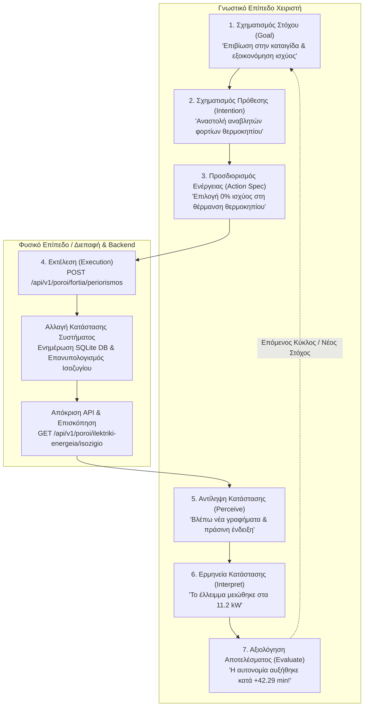
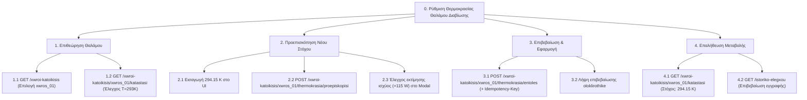
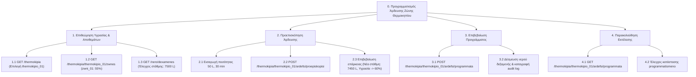
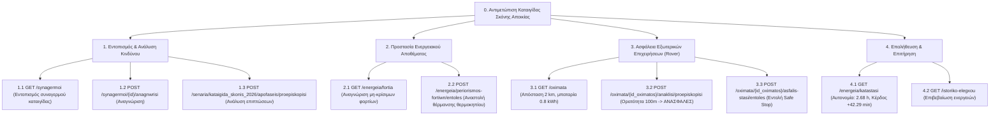

# Αντιστοίχιση HTA και 7 Σταδίων Δράσης του Norman στο API

Το έγγραφο αυτό αποτυπώνει πώς η αρχιτεκτονική του backend υποστηρίζει την Ιεραρχική Ανάλυση Εργασιών (Hierarchical Task Analysis - HTA) και τα 7 Στάδια Δράσης του Don Norman (Norman's 7 Stages of Action) για ασφαλή αλληλεπίδραση ανθρώπου-συστήματος σε κρίσιμα περιβάλλοντα. Παρέχονται πλήρη διαγράμματα για να διευκολυνθεί η ενσωμάτωση από την ομάδα του Frontend.

---

## 1. Ο Κύκλος των 7 Σταδίων Δράσης του Norman

### Αναλυτική Αντιστοίχιση Σταδίων Norman στο API

| Στάδιο Norman | Περιγραφή Ανθρώπινης Δράσης | Υποστήριξη / Επικοινωνία από το Backend API |
| :--- | :--- | :--- |
| **1. Στόχος (Goal)** | Ο χειριστής αποφασίζει ότι απαιτείται εξοικονόμηση ενέργειας λόγω καταιγίδας. | `GET /api/v1/synopsi` παρέχει άμεση επισκόπηση ελλείμματος και αυτονομίας. |
| **2. Πρόθεση (Intention)** | Πρόθεση αναστολής αναβλητών φορτίων θέρμανσης θερμοκηπίου. | `GET /api/v1/energeia/fortia` επιστρέφει λίστα υποψήφιων φορτίων. |
| **3. Προσδιορισμός (Action Spec)** | Επιλογή φορτίου και παραμέτρων περιορισμού (π.χ. $0\%$ ισχύς). | Προδιαγραφή DTO `AitimaPeriorismouFortiwn`. |
| **4. Εκτέλεση (Execution)** | Αποστολή αιτήματος προεπισκόπησης και επιβεβαίωσης. | `POST /api/v1/energeia/periorismos-fortiwn/entoles`. |
| **5. Αντίληψη (Perceive)** | Παρατήρηση της απόκρισης και των νέων μετρήσεων. | Επιστροφή JSON με `nea_katastasi: "anastoli"` και ενημερωμένες μετρήσεις ισχύος. |
| **6. Ερμηνεία (Interpret)** | Κατανόηση ότι η εξοικονόμηση ισχύος επιτεύχθηκε και οι μπαταρίες ανακουφίστηκαν. | `GET /api/v1/energeia/katastasi` δείχνει μειωμένο έλλειμμα ($11.2 \, kW$). |
| **7. Αξιολόγηση (Evaluate)** | Σύγκριση της νέας αυτονομίας ($2.68 \, h$) με τον αρχικό στόχο επιβίωσης. | Επιβεβαίωση αύξησης αυτονομίας κατά $+42.29 \, \text{min}$. |

---

## 2. Ιεραρχική Ανάλυση Εργασιών (HTA Trees)

### HTA 1: Ρύθμιση Θερμοκρασίας Θαλάμου (Εργασία 1 Παρουσίασης)

---

### HTA 2: Προγραμματισμός Άρδευσης Θερμοκηπίου (Εργασία 1 Παρουσίασης)

---

### HTA 3: Διαχείριση Κρίσης Καταιγίδας Σκόνης (Τελική Εργασία)

