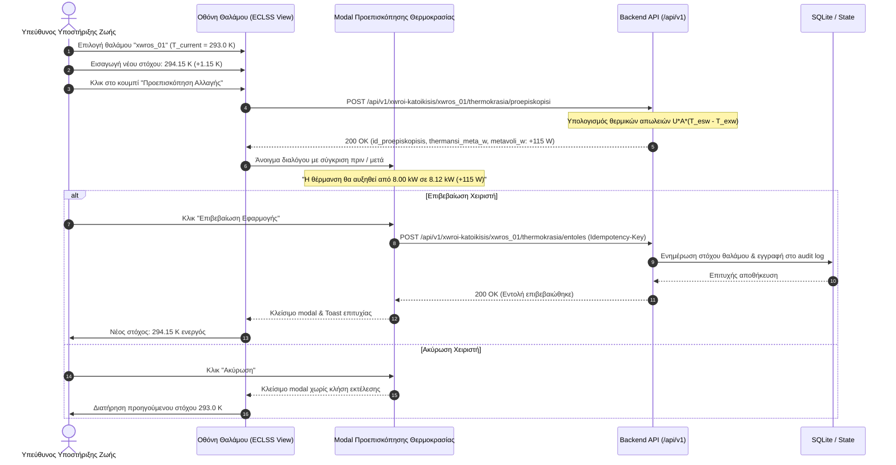
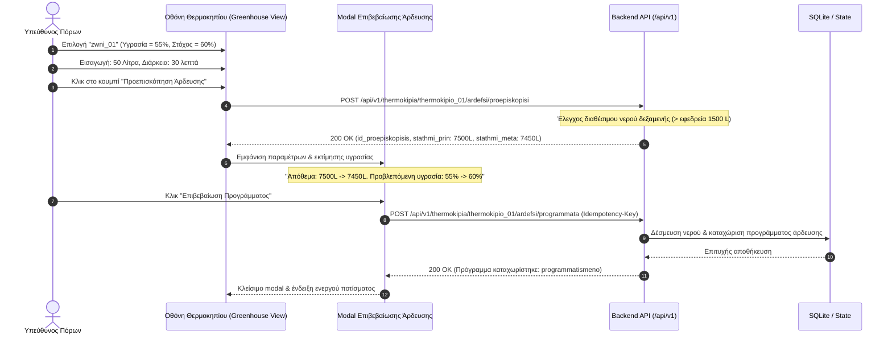
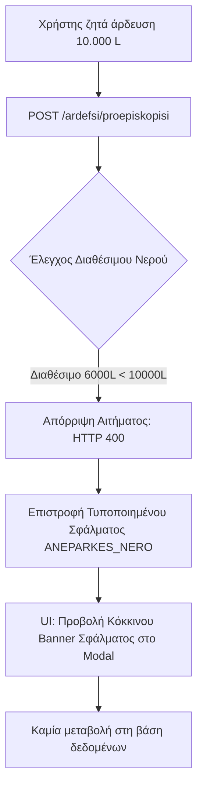

# Ροές Επίδειξης και Σεναρίων (Demonstration Flows)

Το έγγραφο αυτό καθοδηγεί τον χειριστή και την ομάδα του Frontend στην εκτέλεση δύο θεμελιωδών ροών επίδειξης: τη ρύθμιση θερμοκρασίας και τον προγραμματισμό άρδευσης, καθώς και στη δοκιμή σεναρίων σφάλματος (fault-injection).

---

## 1. Ροή Επίδειξης 1: Ρύθμιση Θερμοκρασίας Θαλάμου

### Διάγραμμα Αλληλεπίδρασης UI & Backend



### Βήμα 1: Αίτημα Προεπισκόπησης (cURL)
```bash
curl -X POST http://localhost:8000/api/v1/xwroi-katoikisis/xwros_01/thermokrasia/proepiskopisi \
  -H "Content-Type: application/json" \
  -H "X-ID-Xristi: xristis_01" \
  -H "X-Rolos: ypefthynos_ypostiriksis_zwis" \
  -d '{
    "epithymiti_thermokrasia_k": 294.15,
    "anamenomeni_ekdosi_katastasis": 1
  }'
```
**Πραγματική Απόκριση Backend (200 OK):**
```json
{
  "id_proepiskopisis": "proep_therm_0bb9898a",
  "id_xwrou": "xwros_01",
  "ekdosi_senariou": 1,
  "trexousa": {
    "thermokrasia_k": 293.0,
    "epithymiti_thermokrasia_k": 293.0
  },
  "zitoumeni": {
    "epithymiti_thermokrasia_k": 294.15
  },
  "montelo": {
    "id_montelou": "thermikes_apwleies_v1",
    "eksiswsi": "U * A * (T_esw - T_exw)"
  },
  "eisodoi": {
    "syntelestis_thermoperatotitas_w_m2k": 0.2,
    "epifaneia_m2": 500.0,
    "thermokrasia_exwteriki_k": 213.0
  },
  "epiptwsi": {
    "thermansi_prin_w": 8000.0,
    "thermansi_meta_w": 8115.0,
    "metavoli_w": 115.0
  },
  "proeidopoiiseis": [],
  "apaiteitai_epivevaiwsi": true,
  "xronos_dimiourgias": "2026-11-09T23:05:54.424832+00:00"
}
```

### Βήμα 2: Προβολή στο UI
Ο χρήστης βλέπει την πρόβλεψη στην οθόνη: *"Η νέα ρύθμιση θα αυξήσει την κατανάλωση θέρμανσης κατά 115 W (από 8000 W σε 8115 W). Επιθυμείτε εφαρμογή;"*.

### Βήμα 3: Επιβεβαίωση Εντολής (cURL)
```bash
curl -X POST http://localhost:8000/api/v1/xwroi-katoikisis/xwros_01/thermokrasia/entoles \
  -H "Content-Type: application/json" \
  -H "X-ID-Xristi: xristis_01" \
  -H "X-Rolos: ypefthynos_ypostiriksis_zwis" \
  -H "Idempotency-Key: idem-temp-step-3" \
  -d '{
    "id_proepiskopisis": "proep_therm_0bb9898a",
    "anamenomeni_ekdosi_katastasis": 1
  }'
```
**Αποτέλεσμα:** Ο στόχος ενημερώνεται, καταχωρείται εγγραφή στο audit log, και η νέα θερμοκρασία είναι ενεργή.

---

## 2. Ροή Επίδειξης 2: Άρδευση Θερμοκηπίου

### Διάγραμμα Αλληλεπίδρασης UI & Backend



### Βήμα 1: Αίτημα Προεπισκόπησης (cURL)
```bash
curl -X POST http://localhost:8000/api/v1/thermokipia/thermokipio_01/ardefsi/proepiskopisi \
  -H "Content-Type: application/json" \
  -H "X-ID-Xristi: xristis_02" \
  -H "X-Rolos: ypefthynos_porwn" \
  -d '{
    "id_zwnis": "zwni_01",
    "posotita_nerou_l": 50.0,
    "diarkeia_lepta": 30
  }'
```
**Πραγματική Απόκριση Backend (200 OK):**
```json
{
  "id_proepiskopisis": "proep_ardefsi_61e6164e",
  "id_thermokipiou": "thermokipio_01",
  "id_zwnis": "zwni_01",
  "id_dexamenis": "dexameni_01",
  "posotita_nerou_l": 50.0,
  "diarkeia_lepta": 30,
  "xronos_enarksis": "2026-11-09T23:05:54.433989+00:00",
  "stathmi_prin_l": 7500.0,
  "stathmi_meta_l": 7450.0,
  "ygrasia_prin": 0.55,
  "ygrasia_meta_ektimwmeni": 0.6,
  "eparkis_stathmi": true,
  "xronos_dimiourgias": "2026-11-09T23:05:54.434005+00:00"
}
```

### Βήμα 2: Επιβεβαίωση Εντολής (cURL)
```bash
curl -X POST http://localhost:8000/api/v1/thermokipia/thermokipio_01/ardefsi/programmata \
  -H "Content-Type: application/json" \
  -H "X-ID-Xristi: xristis_02" \
  -H "X-Rolos: ypefthynos_porwn" \
  -H "Idempotency-Key: idem-ard-step-2" \
  -d '{
    "id_proepiskopisis": "proep_ardefsi_61e6164e"
  }'
```
**Αποτέλεσμα:** Το απόθεμα νερού της δεξαμενής μειώνεται στα 7.450 L, δημιουργείται εγγραφή στο πρόγραμμα άρδευσης με κατάσταση `programmatismeno`, και η ενέργεια καταγράφεται στο audit log.

---

## 3. Δοκιμή Σφάλματος: Ανεπάρκεια Νερού (Fault Injection)

### Διάγραμμα Ροής Σφάλματος



### Κλήση cURL
```bash
curl -X POST http://localhost:8000/api/v1/thermokipia/thermokipio_01/ardefsi/proepiskopisi \
  -H "Content-Type: application/json" \
  -H "X-ID-Xristi: xristis_02" \
  -H "X-Rolos: ypefthynos_porwn" \
  -d '{
    "id_zwnis": "zwni_01",
    "posotita_nerou_l": 10000.0,
    "diarkeia_lepta": 60
  }'
```
**Πραγματική Απόκριση (400 Bad Request):**
```json
{
  "sfalma": {
    "kodikos": "ANEPARKES_NERO",
    "minyma": "Το διαθέσιμο νερό πάνω από την εφεδρεία δεν επαρκεί για την άρδευση.",
    "leptomereies": {
      "diathesimo_l": 6000.0,
      "zitoumeno_l": 10000.0,
      "efedreia_asfaleias_l": 1500.0
    },
    "id_aitimatos": null,
    "epanalipsimo": false
  }
}
```
