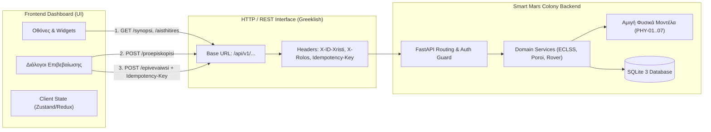
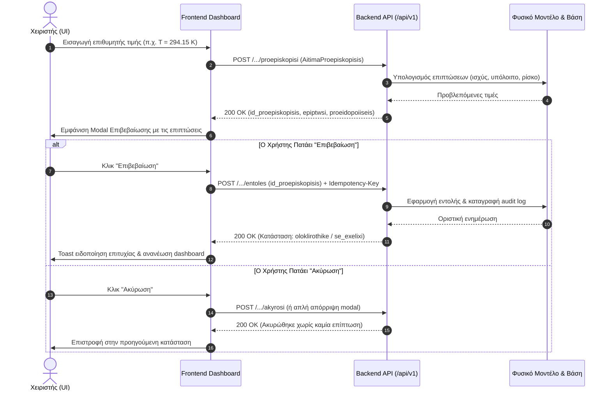
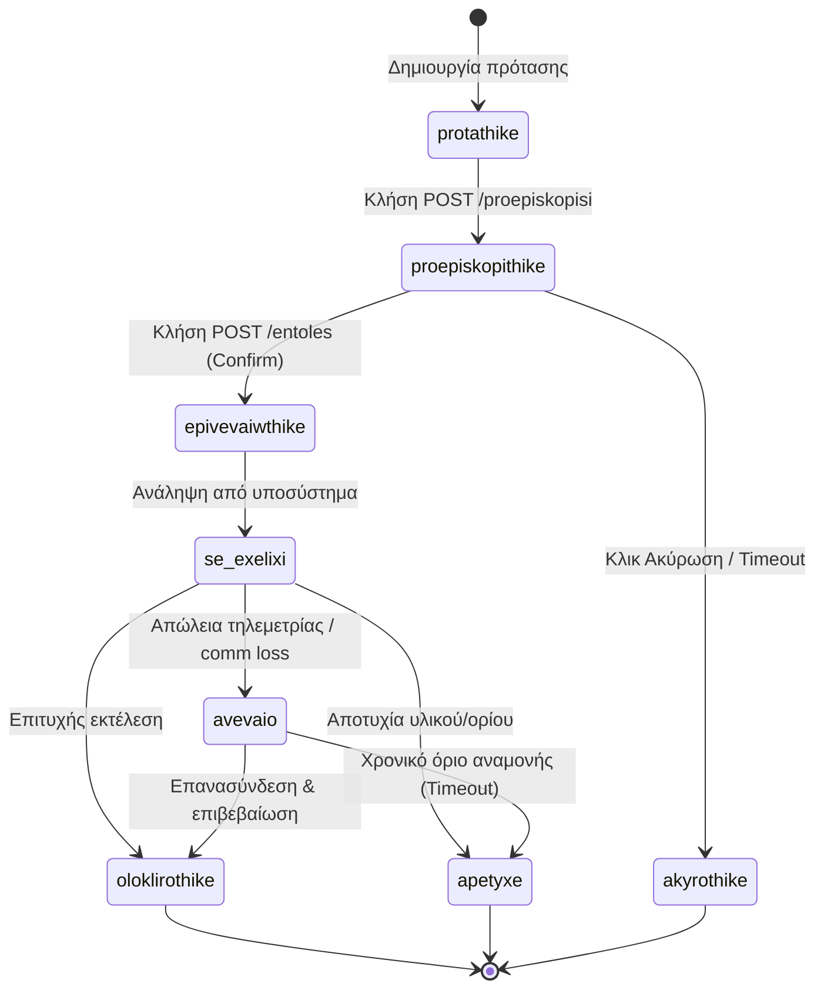

# Συμβόλαιο Επικοινωνίας Frontend - Backend

Το παρόν έγγραφο ορίζει το επίσημο τεχνικό συμβόλαιο διεπαφής μεταξύ του Frontend Dashboard και του Backend API του **Smart Mars Colony**. Έχει γραφτεί αναλυτικά με διαγράμματα και επεξηγήσεις ώστε να καθοδηγήσει πλήρως τη συνάδελφο του Frontend στην υλοποίηση του UI.

---

## 1. Βασικές Αρχές Διεπαφής & Αρχιτεκτονική Επικοινωνίας



- **Πρωτόκολλο:** HTTP/1.1 μέσω REST & JSON.
- **Κοινή Ρίζα Endpoints:** `/api/v1`
- **Κανόνας Greeklish (§0A):** Όλα τα JSON κλειδιά, παράμετροι διαδρομών (path parameters) και τιμές enums ακολουθούν αυστηρά λατινική μεταγραφή ελληνικών λέξεων (ASCII).
- **Μονάδες Μέτρησης:**
  - Θερμοκρασία: Kelvin ($K$) ως εσωτερική τιμή, με υποστήριξη βαθμών Κελσίου ($^\circ C$) στις αποκρίσεις.
  - Ενέργεια / Ισχύς: $kW$ για ισχύ, $kWh$ για αποθηκευμένη ενέργεια.
  - Όγκος: Λίτρα ($L$) ή κυβικά μέτρα ($m^3$).
  - Πίεση: Pascals ($Pa$) ή $kPa$.

---

## 2. Επικεφαλίδες Αιτημάτων (Request Headers)

| Επικεφαλίδα | Υποχρεωτική | Περιγραφή | Παράδειγμα |
| :--- | :---: | :--- | :--- |
| `Content-Type` | Ναι (στα POST) | Μορφή σώματος αιτήματος | `application/json` |
| `X-ID-Xristi` | Ναι (στα προστατευμένα) | Αναγνωριστικό συνδεδεμένου χρήστη | `xristis_01` |
| `X-Rolos` | Ναι (στα προστατευμένα) | Ενεργός ρόλος για το αίτημα | `ypefthynos_ypostiriksis_zwis` |
| `Idempotency-Key` | Προαιρετική (Συνιστάται στα Confirm) | Μοναδικό UUID κλειδί αποτροπής διπλής εκτέλεσης | `c2a688b1-36f1-4db8-bcae-ec15e0e01234` |

---

## 3. Κύκλος Ζωής Εντολών Δύο Βημάτων (Preview / Confirm / Cancel Pattern)

Για λόγους ασφάλειας στον Άρη, καμία κρίσιμη ενέργεια (αλλαγή θερμοκρασίας, άρδευση, διακοπή φορτίου, κίνηση rover) δεν εκτελείται άμεσα με ένα κλικ. Αντίθετα, ακολουθείται η παρακάτω ροή:



---

## 4. Μηχανή Καταστάσεων Εντολών (Command State Machine)



---

## 5. Τυποποιημένη Δομή Απόκρισης Μέτρησης Αισθητήρα

Όλες οι αποκρίσεις που αφορούν τιμές αισθητήρων ακολουθούν ενιαία δομή:

```json
{
  "megethos": "thermokrasia_thalamou",
  "timi": 293.15,
  "monada": "K",
  "eidos": "metrimeno",
  "pigi": "aisthitiras_th_01",
  "xronos_metrisis": "2026-11-10T00:00:00Z",
  "poiotita": "egkyro",
  "avevaiotita": {
    "apolyti_timi": 0.5,
    "monada": "K",
    "pososto": 0.17
  },
  "tasi": "statheri",
  "einai_palio": false
}
```

### Επεξήγηση Πεδίων για το Frontend
- `megethos`: Το αναγνωριστικό του μεγέθους σε Greeklish (π.χ. `thermokrasia_eswteriki`, `piesi_pa`, `pososto_oxygonou`).
- `timi`: Η αριθμητική τιμή της μέτρησης.
- `monada`: Η μονάδα μέτρησης (`K`, `Pa`, `kg`, `kW`, `kWh`, `L`, `pososto`).
- `eidos`: `metrimeno` (πραγματική μέτρηση), `ektimimeno` (εκτίμηση μέσω μοντέλου), `provlepsi` (μελλοντική πρόβλεψη), `setpoint` (επιθυμητός στόχος ρύθμισης).
- `poiotita`: `egkyro` (πράσινο badge στο UI), `ypovathmismeno` (κίτρινο badge), `palio` (πορτοκαλί ένδειξη stale data), `apousia` (κόκκινη ένδειξη offline αισθητήρα).
- `avevaiotita`: Προαιρετικό αντικείμενο στατιστικής αβεβαιότητας ($\pm \Delta$).
- `tasi`: `afksousa` ($\uparrow$), `fthinousa` ($\downarrow$), `statheri` ($\rightarrow$), `agnwsti`.

---

## 6. Τυποποιημένος Φάκελος Σφάλματος (Unified Error Envelope)

Όλες οι αποκρίσεις αποτυχίας (HTTP 400, 403, 404, 409, 422, 500) επιστρέφουν JSON με ρίζα `sfalma`:

```json
{
  "sfalma": {
    "kodikos": "ANEPARKES_NERO",
    "minyma": "Το διαθέσιμο νερό πάνω από την εφεδρεία δεν επαρκεί για την άρδευση.",
    "leptomereies": {
      "diathesimo_l": 6000.0,
      "zitoumeno_l": 10000.0,
      "efedreia_asfaleias_l": 1500.0
    },
    "id_aitimatos": null,
    "epanalipsimo": false
  }
}
```

### Πίνακας Κωδικών Σφαλμάτων Domain

| Κωδικός (`kodikos`) | HTTP Status | Σημασία & Οδηγία για το UI |
| :--- | :---: | :--- |
| `ANEPARKES_NERO` | 400 | Το αιτούμενο νερό υπερβαίνει το διαθέσιμο. Εμφάνιση κόκκινου banner στο modal άρδευσης. |
| `EKTOS_ORIWN` | 400 | Η αιτούμενη τιμή (π.χ. θερμοκρασία) είναι εκτός επιτρεπτών ορίων. |
| `ANARMODIOS_ROLOS` | 403 | Ο χρήστης δεν έχει δικαίωμα για την ενέργεια. Εμφάνιση απαγορευτικού μηνύματος ή πρόταση μεταβίβασης ρόλου. |
| `DEN_VRETHIKE` | 404 | Ο πόρος (θάλαμος, όχημα, δεξαμενή) δεν βρέθηκε. |
| `STALE_PREVIEW` / `DIENEXI` | 409 | Η προεπισκόπηση έληξε ή άλλαξαν τα δεδομένα ενδιάμεσα. Απαιτείται ανανέωση προεπισκόπησης. |
| `AKYRI_TIMI` | 422 | Σφάλμα validation πεδίων εισόδου από το Pydantic. |
| `ESWTERIKO_SFALMA` | 500 | Απρόβλεπτο σφάλμα εξυπηρετητή. Εμφάνιση γενικού μηνύματος αποτυχίας. |
